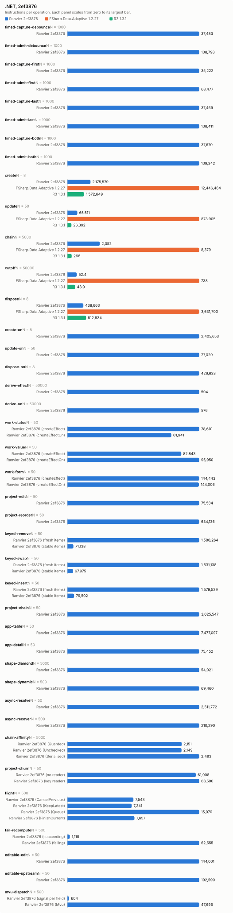
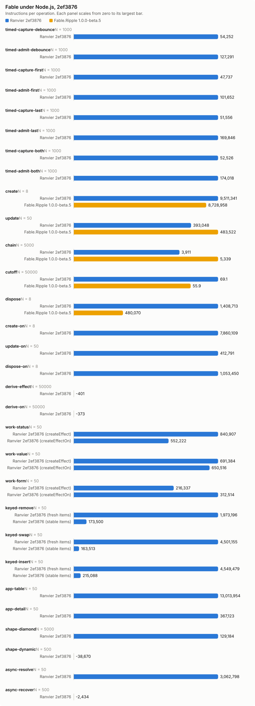

# Counter bench, 2ef3876

- Date: 2026-10-15 17:07:05Z
- Machine: AMD64 Family 26 Model 68 Stepping 0, AuthenticAMD, 24 logical processors, Microsoft Windows 10.0.26200, .NET 10.0.13
- Instructions: per-context-switch PMC counters (InstructionRetired, TotalCycles, BranchMispredictions)
- Library counters: from a separate RanvierCounters build (--counters-worker)
- Versions: .NET 10.0.13, FSharp.Data.Adaptive 1.2.27, R3 1.3.1, Ranvier 2ef3876
- Worker environment: DOTNET_TieredCompilation=0 DOTNET_TieredPGO=0 DOTNET_ReadyToRun=0 DOTNET_gcServer=0
- RanvierTrace: false
- Every figure is (m(2N) - m(N)) / N. Processor counters are the median over runs.
- Instruction counts differing by under 5 % are within run-to-run noise. Compare only reports taken at the same --scale.

## Engine differences

- R3 pushes each write straight to its subscribers, without batching or glitch-free ordering. Its chain is `Select` operators holding no cached value.
- FSharp.Data.Adaptive dispose removes the callback subscriptions only. The `AVal.map2` nodes stay in the weak output sets of their `cval`s until collected.

## timed-capture-debounce: capture a changed input in 64 timed nodes (N = 1000)

| Engine | instr/op | cycles/op | br-miss/op | intervals N/2N | bytes/op | objects/op | counters/op |
| --- | ---: | ---: | ---: | ---: | ---: | ---: | --- |
| Ranvier 2ef3876 | 37,483.37 | 13,251.18 | 2.41 | 4/2 | 0 | 0 | MemoRecomputes 64, Flushes 1 |

## timed-admit-debounce: capture and admit in 64 timed nodes (N = 1000)

| Engine | instr/op | cycles/op | br-miss/op | intervals N/2N | bytes/op | objects/op | counters/op |
| --- | ---: | ---: | ---: | ---: | ---: | ---: | --- |
| Ranvier 2ef3876 | 108,797.76 | 43,809.45 | 9.41 | 1/4 | 1,536 | 0 | MemoRecomputes 64, EffectRuns 64, Flushes 65 |

## timed-capture-first: capture a changed input in 64 timed nodes (N = 1000)

| Engine | instr/op | cycles/op | br-miss/op | intervals N/2N | bytes/op | objects/op | counters/op |
| --- | ---: | ---: | ---: | ---: | ---: | ---: | --- |
| Ranvier 2ef3876 | 35,222.39 | 12,029.37 | 2.61 | 1/2 | 0 | 0 | MemoRecomputes 64, Flushes 1 |

## timed-admit-first: capture and admit in 64 timed nodes (N = 1000)

| Engine | instr/op | cycles/op | br-miss/op | intervals N/2N | bytes/op | objects/op | counters/op |
| --- | ---: | ---: | ---: | ---: | ---: | ---: | --- |
| Ranvier 2ef3876 | 68,476.83 | 25,157.95 | 4.88 | 4/2 | 0 | 0 | MemoRecomputes 64, EffectRuns 64, Flushes 1 |

## timed-capture-last: capture a changed input in 64 timed nodes (N = 1000)

| Engine | instr/op | cycles/op | br-miss/op | intervals N/2N | bytes/op | objects/op | counters/op |
| --- | ---: | ---: | ---: | ---: | ---: | ---: | --- |
| Ranvier 2ef3876 | 37,469.36 | 12,485.92 | 2.24 | 2/1 | 0 | 0 | MemoRecomputes 64, Flushes 1 |

## timed-admit-last: capture and admit in 64 timed nodes (N = 1000)

| Engine | instr/op | cycles/op | br-miss/op | intervals N/2N | bytes/op | objects/op | counters/op |
| --- | ---: | ---: | ---: | ---: | ---: | ---: | --- |
| Ranvier 2ef3876 | 108,410.76 | 47,810.73 | 6.75 | 3/4 | 1,536 | 0 | MemoRecomputes 64, EffectRuns 64, Flushes 65 |

## timed-capture-both: capture a changed input in 64 timed nodes (N = 1000)

| Engine | instr/op | cycles/op | br-miss/op | intervals N/2N | bytes/op | objects/op | counters/op |
| --- | ---: | ---: | ---: | ---: | ---: | ---: | --- |
| Ranvier 2ef3876 | 37,670.06 | 16,065.97 | 2.73 | 2/1 | 0 | 0 | MemoRecomputes 64, Flushes 1 |

## timed-admit-both: capture and admit in 64 timed nodes (N = 1000)

| Engine | instr/op | cycles/op | br-miss/op | intervals N/2N | bytes/op | objects/op | counters/op |
| --- | ---: | ---: | ---: | ---: | ---: | ---: | --- |
| Ranvier 2ef3876 | 109,341.64 | 45,430.17 | 11.79 | 4/9 | 1,536 | 0 | MemoRecomputes 64, EffectRuns 64, Flushes 65 |

## create: one root of 1000 rows (N = 8)

| Engine | instr/op | cycles/op | br-miss/op | intervals N/2N | bytes/op | objects/op | counters/op |
| --- | ---: | ---: | ---: | ---: | ---: | ---: | --- |
| Ranvier 2ef3876 | 2,175,579 | 895,954.25 | 982.50 | 1/1 | 594,520 | 2,002 | SignalsCreated 1,001, EffectsCreated 1,000, OwnersCreated 1, EdgesAdded 2,000, ObserverInserts 2,000, EffectRuns 1,000, Flushes 1,000 |
| FSharp.Data.Adaptive 1.2.27 | 12,446,463.50 | 7,257,587.75 | 8,926.62 | 2/6 | 2,413,717 | n/a | n/a |
| R3 1.3.1 | 1,572,649.38 | 863,957.75 | 435.62 | 1/2 | 584,160 | n/a | n/a |

## update: write every 10th of 1000 rows (N = 50)

| Engine | instr/op | cycles/op | br-miss/op | intervals N/2N | bytes/op | objects/op | counters/op |
| --- | ---: | ---: | ---: | ---: | ---: | ---: | --- |
| Ranvier 2ef3876 | 65,510.78 | 38,878.96 | 10.16 | 1/1 | 0 | 0 | EffectRuns 100, Flushes 100 |
| FSharp.Data.Adaptive 1.2.27 | 873,905.38 | 426,310.96 | 404.60 | 1/2 | 63,200 | n/a | n/a |
| R3 1.3.1 | 26,392.42 | 10,668.48 | 0.12 | 1/1 | 0 | n/a | n/a |

## chain: write the source of 4 memos, read the tail (N = 5000)

| Engine | instr/op | cycles/op | br-miss/op | intervals N/2N | bytes/op | objects/op | counters/op |
| --- | ---: | ---: | ---: | ---: | ---: | ---: | --- |
| Ranvier 2ef3876 | 2,052.12 | 724.65 | 0.97 | 1/2 | 0 | 0 | MemoRecomputes 4 |
| FSharp.Data.Adaptive 1.2.27 | 8,378.85 | 3,722.06 | 1.85 | 1/2 | 472 | n/a | n/a |
| R3 1.3.1 | 266.28 | 130.19 | -0.06 | 1/2 | 0 | n/a | n/a |

## cutoff: write an equal value to an observed source (N = 50000)

| Engine | instr/op | cycles/op | br-miss/op | intervals N/2N | bytes/op | objects/op | counters/op |
| --- | ---: | ---: | ---: | ---: | ---: | ---: | --- |
| Ranvier 2ef3876 | 52.43 | 19.62 | 0.01 | 1/5 | 0 | 0 | 0 |
| FSharp.Data.Adaptive 1.2.27 | 738.04 | 387.81 | 0.30 | 4/9 | 352 | n/a | n/a |
| R3 1.3.1 | 43.00 | 28.49 | 0.00 | 2/2 | 0 | n/a | n/a |

## dispose: dispose one root of 1000 rows (N = 8)

| Engine | instr/op | cycles/op | br-miss/op | intervals N/2N | bytes/op | objects/op | counters/op |
| --- | ---: | ---: | ---: | ---: | ---: | ---: | --- |
| Ranvier 2ef3876 | 438,662.75 | 334,132.25 | 80.25 | 1/1 | 56 | 0 | EdgesRemoved 2,000, ObserverRemoves 2,000 |
| FSharp.Data.Adaptive 1.2.27 | 3,631,699.50 | 3,220,753.12 | 3,488.62 | 3/4 | 0 | n/a | n/a |
| R3 1.3.1 | 512,934.50 | 548,503.88 | 546.88 | 1/1 | 0 | n/a | n/a |

## create-on: one root of 1000 createEffectOn rows (N = 8)

| Engine | instr/op | cycles/op | br-miss/op | intervals N/2N | bytes/op | objects/op | counters/op |
| --- | ---: | ---: | ---: | ---: | ---: | ---: | --- |
| Ranvier 2ef3876 | 2,405,652.75 | 1,132,549.88 | 1,029.12 | 1/2 | 506,664 | 2,002 | SignalsCreated 1,001, EffectsCreated 1,000, OwnersCreated 1, EdgesAdded 2,000, ObserverInserts 2,000, EffectRuns 1,000, Flushes 1,000 |

## update-on: write every 10th of 1000 createEffectOn rows (N = 50)

| Engine | instr/op | cycles/op | br-miss/op | intervals N/2N | bytes/op | objects/op | counters/op |
| --- | ---: | ---: | ---: | ---: | ---: | ---: | --- |
| Ranvier 2ef3876 | 77,029.16 | 30,957.40 | 1.18 | 2/2 | 0 | 0 | EffectRuns 100, Flushes 100 |

## dispose-on: dispose one root of 1000 createEffectOn rows (N = 8)

| Engine | instr/op | cycles/op | br-miss/op | intervals N/2N | bytes/op | objects/op | counters/op |
| --- | ---: | ---: | ---: | ---: | ---: | ---: | --- |
| Ranvier 2ef3876 | 426,633.12 | 189,077 | 44.88 | 1/3 | 56 | 0 | EdgesRemoved 2,000, ObserverRemoves 2,000 |

## derive-effect: write a new value whose derived value is unchanged, Effect (N = 50000)

| Engine | instr/op | cycles/op | br-miss/op | intervals N/2N | bytes/op | objects/op | counters/op |
| --- | ---: | ---: | ---: | ---: | ---: | ---: | --- |
| Ranvier 2ef3876 | 593.90 | 183.29 | 0.00 | 5/3 | 0 | 0 | EffectRuns 1, Flushes 1 |

## derive-on: write a new value whose derived value is unchanged, createEffectOn (N = 50000)

| Engine | instr/op | cycles/op | br-miss/op | intervals N/2N | bytes/op | objects/op | counters/op |
| --- | ---: | ---: | ---: | ---: | ---: | ---: | --- |
| Ranvier 2ef3876 | 576.23 | 173.60 | 0.01 | 2/3 | 0 | 0 | EffectRuns 1, Flushes 1 |

## work-status: write every 10th of 1000 rows; the act formats a label, 1 write in 10 changes it (N = 50)

| Engine | instr/op | cycles/op | br-miss/op | intervals N/2N | bytes/op | objects/op | counters/op |
| --- | ---: | ---: | ---: | ---: | ---: | ---: | --- |
| Ranvier 2ef3876 (createEffect) | 78,610.46 | 29,814.68 | 9.46 | 1/1 | 3,980 | 0 | EffectRuns 100, Flushes 100 |
| Ranvier 2ef3876 (createEffectOn) | 61,941.04 | 15,101.18 | -4.92 | 2/1 | 398.40 | 0 | EffectRuns 100, Flushes 100 |

## work-value: write every 10th of 1000 rows; the act formats a label, every write changes it (N = 50)

| Engine | instr/op | cycles/op | br-miss/op | intervals N/2N | bytes/op | objects/op | counters/op |
| --- | ---: | ---: | ---: | ---: | ---: | ---: | --- |
| Ranvier 2ef3876 (createEffect) | 82,842.96 | 25,010.40 | 2.96 | 5/1 | 6,467.20 | 0 | EffectRuns 100, Flushes 100 |
| Ranvier 2ef3876 (createEffectOn) | 95,949.70 | 22,805.08 | 7.62 | 3/2 | 6,467.20 | 0 | EffectRuns 100, Flushes 100 |

## work-form: write one field of each of 125 8-field forms; validity feeds a signal and an effect (N = 50)

| Engine | instr/op | cycles/op | br-miss/op | intervals N/2N | bytes/op | objects/op | counters/op |
| --- | ---: | ---: | ---: | ---: | ---: | ---: | --- |
| Ranvier 2ef3876 (createEffect) | 144,443.16 | 43,474.48 | 19.92 | 2/2 | 0 | 0 | EffectRuns 126.02, Flushes 125 |
| Ranvier 2ef3876 (createEffectOn) | 144,005.54 | 34,283.20 | 15.58 | 1/1 | 0 | 0 | EffectRuns 126.02, Flushes 125 |

## project-edit: change one row of a 1000-row projection (N = 50)

| Engine | instr/op | cycles/op | br-miss/op | intervals N/2N | bytes/op | objects/op | counters/op |
| --- | ---: | ---: | ---: | ---: | ---: | ---: | --- |
| Ranvier 2ef3876 | 75,583.62 | 21,065.32 | 8.78 | 1/4 | 168 | 0 | MemoRecomputes 1, EffectRuns 1, Flushes 1 |

## project-reorder: reverse a 1000-row projection (N = 50)

| Engine | instr/op | cycles/op | br-miss/op | intervals N/2N | bytes/op | objects/op | counters/op |
| --- | ---: | ---: | ---: | ---: | ---: | ---: | --- |
| Ranvier 2ef3876 | 634,135.54 | 252,232.72 | 21.28 | 5/2 | 8,216 | 0 | Flushes 1 |

## keyed-remove: alternately remove and restore the middle row of a 1000-row projection (N = 50)

| Engine | instr/op | cycles/op | br-miss/op | intervals N/2N | bytes/op | objects/op | counters/op |
| --- | ---: | ---: | ---: | ---: | ---: | ---: | --- |
| Ranvier 2ef3876 (fresh items) | 1,580,264.42 | 623,049.16 | 113.74 | 2/4 | 8,516 | 1 | SignalsCreated 0.50, MemosCreated 0.50, EdgesAdded 1.50, EdgesRemoved 1.50, ObserverInserts 1.50, ObserverRemoves 1.50, MemoRecomputes 999.50, EffectRuns 3, Flushes 1 |
| Ranvier 2ef3876 (stable items) | 71,137.84 | 20,973.18 | 4.24 | 4/1 | 8,516 | 1 | SignalsCreated 0.50, MemosCreated 0.50, EdgesAdded 1.50, EdgesRemoved 1.50, ObserverInserts 1.50, ObserverRemoves 1.50, MemoRecomputes 0.50, EffectRuns 3, Flushes 1 |

## keyed-swap: alternately swap and restore the second and second-to-last rows of a 1000-row projection (N = 50)

| Engine | instr/op | cycles/op | br-miss/op | intervals N/2N | bytes/op | objects/op | counters/op |
| --- | ---: | ---: | ---: | ---: | ---: | ---: | --- |
| Ranvier 2ef3876 (fresh items) | 1,631,138.20 | 678,186.22 | 176.32 | 2/3 | 8,216 | 0 | MemoRecomputes 1,000, EffectRuns 2, Flushes 1 |
| Ranvier 2ef3876 (stable items) | 67,975.20 | 18,836.44 | 2.26 | 2/2 | 8,216 | 0 | EffectRuns 2, Flushes 1 |

## keyed-insert: alternately prepend a row and restore of a 1000-row projection (N = 50)

| Engine | instr/op | cycles/op | br-miss/op | intervals N/2N | bytes/op | objects/op | counters/op |
| --- | ---: | ---: | ---: | ---: | ---: | ---: | --- |
| Ranvier 2ef3876 (fresh items) | 1,579,529.12 | 597,355.36 | 103.88 | 2/4 | 8,524 | 1 | SignalsCreated 0.50, MemosCreated 0.50, EdgesAdded 1.50, EdgesRemoved 1.50, ObserverInserts 1.50, ObserverRemoves 1.50, MemoRecomputes 1,000.50, EffectRuns 2, Flushes 1 |
| Ranvier 2ef3876 (stable items) | 79,501.84 | 21,358.08 | -0.40 | 1/1 | 8,524 | 1 | SignalsCreated 0.50, MemosCreated 0.50, EdgesAdded 1.50, EdgesRemoved 1.50, ObserverInserts 1.50, ObserverRemoves 1.50, MemoRecomputes 0.50, EffectRuns 2, Flushes 1 |

## project-chain: change one row of a 1000-row filter, sortBy, map chain (N = 50)

| Engine | instr/op | cycles/op | br-miss/op | intervals N/2N | bytes/op | objects/op | counters/op |
| --- | ---: | ---: | ---: | ---: | ---: | ---: | --- |
| Ranvier 2ef3876 | 3,025,547.46 | 865,912.42 | 369.04 | 2/11 | 204,944 | 0 | MemoRecomputes 6, EffectRuns 2, Flushes 1 |

## app-table: alternate a filter query and a sort direction over 1000 rows (N = 50)

| Engine | instr/op | cycles/op | br-miss/op | intervals N/2N | bytes/op | objects/op | counters/op |
| --- | ---: | ---: | ---: | ---: | ---: | ---: | --- |
| Ranvier 2ef3876 | 7,477,096.78 | 2,676,247.26 | 1,415.64 | 7/10 | 422,480.80 | 240 | SignalsCreated 120, MemosCreated 120, EdgesAdded 760.50, EdgesRemoved 760.50, ObserverInserts 760.50, ObserverRemoves 760.50, MemoRecomputes 980, EffectRuns 1, Flushes 1 |

## app-detail: move the selection over 1000 rows; the detail rebuilds 20 memo and effect pairs (N = 50)

| Engine | instr/op | cycles/op | br-miss/op | intervals N/2N | bytes/op | objects/op | counters/op |
| --- | ---: | ---: | ---: | ---: | ---: | ---: | --- |
| Ranvier 2ef3876 | 75,451.88 | 33,253.42 | 36.86 | 1/1 | 12,960 | 40 | MemosCreated 20, EffectsCreated 20, EdgesAdded 41, EdgesRemoved 41, ObserverInserts 41, ObserverRemoves 41, MemoRecomputes 21, EffectRuns 24, Flushes 1 |

## shape-diamond: write a source read by 100 memos joined by one (N = 5000)

| Engine | instr/op | cycles/op | br-miss/op | intervals N/2N | bytes/op | objects/op | counters/op |
| --- | ---: | ---: | ---: | ---: | ---: | ---: | --- |
| Ranvier 2ef3876 | 54,020.78 | 20,077.11 | 3.42 | 6/12 | 0 | 0 | MemoRecomputes 101, EffectRuns 1, Flushes 1 |

## shape-dynamic: alternate a branch flip and a write of every active source of 100 effects (N = 500)

| Engine | instr/op | cycles/op | br-miss/op | intervals N/2N | bytes/op | objects/op | counters/op |
| --- | ---: | ---: | ---: | ---: | ---: | ---: | --- |
| Ranvier 2ef3876 | 69,459.55 | 19,782.73 | 4.20 | 1/2 | 0 | 0 | EdgesAdded 50, EdgesRemoved 50, ObserverInserts 50, ObserverRemoves 50, EffectRuns 100, Flushes 50.50 |

## async-resolve: reload 10 suspense widgets of 10 sources, then settle each (N = 50)

| Engine | instr/op | cycles/op | br-miss/op | intervals N/2N | bytes/op | objects/op | counters/op |
| --- | ---: | ---: | ---: | ---: | ---: | ---: | --- |
| Ranvier 2ef3876 | 2,511,771.66 | 1,052,178.30 | 1,569.76 | 2/3 | 71,008 | 0 | EdgesAdded 190, EdgesRemoved 190, ObserverInserts 190, ObserverRemoves 190, EffectRuns 20, Flushes 101 |

## async-recover: fail one source of one error-boundary widget, then settle a replacement (N = 500)

| Engine | instr/op | cycles/op | br-miss/op | intervals N/2N | bytes/op | objects/op | counters/op |
| --- | ---: | ---: | ---: | ---: | ---: | ---: | --- |
| Ranvier 2ef3876 | 210,289.81 | 211,036.18 | 142.26 | 5/5 | 180,422.29 | 0 | EdgesAdded 20, EdgesRemoved 20, ObserverInserts 20, ObserverRemoves 20, EffectRuns 4, Flushes 4 |

## chain-affinity: write the source of 4 memos, read the tail, per thread affinity (N = 5000)

| Engine | instr/op | cycles/op | br-miss/op | intervals N/2N | bytes/op | objects/op | counters/op |
| --- | ---: | ---: | ---: | ---: | ---: | ---: | --- |
| Ranvier 2ef3876 (Guarded) | 2,151.05 | 863.17 | 1.03 | 1/1 | 0 | 0 | MemoRecomputes 4 |
| Ranvier 2ef3876 (Unchecked) | 2,148.73 | 800.41 | 0.96 | 3/2 | 0 | 0 | MemoRecomputes 4 |
| Ranvier 2ef3876 (Serialised) | 2,483.20 | 950.49 | 0.97 | 2/1 | 0 | 0 | MemoRecomputes 4 |

## project-churn: replace the last key of a 1000-row projection (N = 50)

| Engine | instr/op | cycles/op | br-miss/op | intervals N/2N | bytes/op | objects/op | counters/op |
| --- | ---: | ---: | ---: | ---: | ---: | ---: | --- |
| Ranvier 2ef3876 (no reader) | 61,907.74 | 34,133.96 | -1.06 | 1/7 | 8,680 | 2 | SignalsCreated 1, MemosCreated 1, EffectRuns 1, Flushes 1 |
| Ranvier 2ef3876 (key reader) | 63,589.70 | 26,184.92 | 1.60 | 1/1 | 9,080 | 2 | SignalsCreated 1, MemosCreated 1, EffectRuns 2, Flushes 1 |

## flight: write an async memo's trigger twice, then settle every flight the writes started (N = 500)

| Engine | instr/op | cycles/op | br-miss/op | intervals N/2N | bytes/op | objects/op | counters/op |
| --- | ---: | ---: | ---: | ---: | ---: | ---: | --- |
| Ranvier 2ef3876 (CancelPrevious) | 7,542.93 | 2,805.26 | 1.59 | 1/3 | 1,720 | 0 | 0 |
| Ranvier 2ef3876 (KeepLatest) | 7,341.34 | 3,171.44 | 1.10 | 2/2 | 1,672 | 0 | 0 |
| Ranvier 2ef3876 (Queue) | 15,069.69 | 6,362.22 | 9.37 | 5/2 | 3,184 | 0 | 0 |
| Ranvier 2ef3876 (FinishCurrent) | 7,657.25 | 5,176.89 | 1.85 | 1/2 | 1,744 | 0 | 0 |

## fail-recompute: re-run a memo and its one reader, then read the reader's failure origin (N = 500)

| Engine | instr/op | cycles/op | br-miss/op | intervals N/2N | bytes/op | objects/op | counters/op |
| --- | ---: | ---: | ---: | ---: | ---: | ---: | --- |
| Ranvier 2ef3876 (succeeding) | 1,118.15 | 622.52 | 0.68 | 2/2 | 0 | 0 | MemoRecomputes 2 |
| Ranvier 2ef3876 (failing) | 62,555.36 | 24,698.72 | 29.41 | 2/2 | 1,576 | 0 | MemoRecomputes 2 |

## editable-edit: edit every 10th of 1000 editables (N = 50)

| Engine | instr/op | cycles/op | br-miss/op | intervals N/2N | bytes/op | objects/op | counters/op |
| --- | ---: | ---: | ---: | ---: | ---: | ---: | --- |
| Ranvier 2ef3876 | 144,001.28 | 47,964.92 | -12.18 | 3/2 | 0 | 0 | MemoRecomputes 100, EffectRuns 100, Flushes 100 |

## editable-upstream: write the seed source of every 10th of 1000 editables (N = 50)

| Engine | instr/op | cycles/op | br-miss/op | intervals N/2N | bytes/op | objects/op | counters/op |
| --- | ---: | ---: | ---: | ---: | ---: | ---: | --- |
| Ranvier 2ef3876 | 192,589.80 | 61,327.28 | 0.08 | 1/1 | 2,400 | 0 | MemoRecomputes 200, EffectRuns 100, Flushes 100 |

## mvu-dispatch: change one field of a 64-field model, one reader per field (N = 500)

| Engine | instr/op | cycles/op | br-miss/op | intervals N/2N | bytes/op | objects/op | counters/op |
| --- | ---: | ---: | ---: | ---: | ---: | ---: | --- |
| Ranvier 2ef3876 (signal per field) | 604.09 | 275.10 | 0.05 | 1/1 | 0 | 0 | EffectRuns 1, Flushes 1 |
| Ranvier 2ef3876 (Mvu) | 47,696.33 | 15,604.95 | 4.69 | 3/2 | 400 | 0 | MemoRecomputes 64, EffectRuns 1, Flushes 1 |

## Calibration, 5 run(s)

Allocations and library counters identical in every run.

| Scenario | Engine | Source | Median/op | Min/op | Max/op | Spread |
| --- | --- | --- | ---: | ---: | ---: | ---: |
| timed-capture-debounce | Ranvier | InstructionRetired | 37,483.37 | 37,448.00 | 40,358.53 | 7.77 % |
| timed-capture-debounce | Ranvier | TotalCycles | 13,251.18 | 8,918.97 | 15,361.31 | 72.23 % |
| timed-capture-debounce | Ranvier | BranchMispredictions | 2.41 | 1.62 | 3.21 | 98.82 % |
| timed-admit-debounce | Ranvier | InstructionRetired | 108,797.76 | 108,145.88 | 114,264.99 | 5.66 % |
| timed-admit-debounce | Ranvier | TotalCycles | 43,809.45 | 37,539.84 | 50,286.77 | 33.96 % |
| timed-admit-debounce | Ranvier | BranchMispredictions | 9.41 | 6.84 | 18.22 | 166.50 % |
| timed-capture-first | Ranvier | InstructionRetired | 35,222.39 | 33,698.14 | 36,592.36 | 8.59 % |
| timed-capture-first | Ranvier | TotalCycles | 12,029.37 | 10,532.34 | 16,528.79 | 56.93 % |
| timed-capture-first | Ranvier | BranchMispredictions | 2.61 | 2.27 | 17.57 | 675.12 % |
| timed-admit-first | Ranvier | InstructionRetired | 68,476.83 | 68,385.22 | 71,349.03 | 4.33 % |
| timed-admit-first | Ranvier | TotalCycles | 25,157.95 | 25,052.57 | 29,714.64 | 18.61 % |
| timed-admit-first | Ranvier | BranchMispredictions | 4.88 | 3.15 | 8.10 | 156.61 % |
| timed-capture-last | Ranvier | InstructionRetired | 37,469.36 | 37,455.97 | 40,361.29 | 7.76 % |
| timed-capture-last | Ranvier | TotalCycles | 12,485.92 | 12,066.20 | 12,653.57 | 4.87 % |
| timed-capture-last | Ranvier | BranchMispredictions | 2.24 | 2.11 | 3.24 | 53.65 % |
| timed-admit-last | Ranvier | InstructionRetired | 108,410.76 | 107,282.79 | 114,564.05 | 6.79 % |
| timed-admit-last | Ranvier | TotalCycles | 47,810.73 | 40,168.06 | 48,014.95 | 19.54 % |
| timed-admit-last | Ranvier | BranchMispredictions | 6.75 | -0.76 | 16.09 | -2,210.89 % |
| timed-capture-both | Ranvier | InstructionRetired | 37,670.06 | 37,576.18 | 40,478.00 | 7.72 % |
| timed-capture-both | Ranvier | TotalCycles | 16,065.97 | 13,625.13 | 19,289.53 | 41.57 % |
| timed-capture-both | Ranvier | BranchMispredictions | 2.73 | 2.15 | 4.87 | 126.89 % |
| timed-admit-both | Ranvier | InstructionRetired | 109,341.64 | 109,116.93 | 114,699.36 | 5.12 % |
| timed-admit-both | Ranvier | TotalCycles | 45,430.17 | 35,081.87 | 52,562.66 | 49.83 % |
| timed-admit-both | Ranvier | BranchMispredictions | 11.79 | 5.09 | 17.18 | 237.32 % |
| create | Ranvier | InstructionRetired | 2,175,579 | 2,122,887.50 | 2,213,503.38 | 4.27 % |
| create | Ranvier | TotalCycles | 895,954.25 | 454,794.75 | 1,153,261.25 | 153.58 % |
| create | Ranvier | BranchMispredictions | 982.50 | 261.50 | 1,282.75 | 390.54 % |
| create | FSharp.Data.Adaptive | InstructionRetired | 12,446,463.50 | 12,323,995.38 | 12,747,980.38 | 3.44 % |
| create | FSharp.Data.Adaptive | TotalCycles | 7,257,587.75 | 6,924,616.12 | 7,901,041.75 | 14.10 % |
| create | FSharp.Data.Adaptive | BranchMispredictions | 8,926.62 | 8,314.75 | 9,344.25 | 12.38 % |
| create | R3 | InstructionRetired | 1,572,649.38 | 1,568,464.50 | 1,602,828.25 | 2.19 % |
| create | R3 | TotalCycles | 863,957.75 | 782,574.12 | 893,397.25 | 14.16 % |
| create | R3 | BranchMispredictions | 435.62 | 178.50 | 512.88 | 187.32 % |
| update | Ranvier | InstructionRetired | 65,510.78 | 65,275.36 | 66,018.42 | 1.14 % |
| update | Ranvier | TotalCycles | 38,878.96 | 25,684.86 | 44,897.40 | 74.80 % |
| update | Ranvier | BranchMispredictions | 10.16 | 8.54 | 21.90 | 156.44 % |
| update | FSharp.Data.Adaptive | InstructionRetired | 873,905.38 | 857,948.44 | 890,388 | 3.78 % |
| update | FSharp.Data.Adaptive | TotalCycles | 426,310.96 | 303,370.76 | 489,071.62 | 61.21 % |
| update | FSharp.Data.Adaptive | BranchMispredictions | 404.60 | 336.90 | 568.44 | 68.73 % |
| update | R3 | InstructionRetired | 26,392.42 | 26,300.10 | 26,473.20 | 0.66 % |
| update | R3 | TotalCycles | 10,668.48 | 8,446.32 | 15,120.54 | 79.02 % |
| update | R3 | BranchMispredictions | 0.12 | -3.32 | 1.76 | -153.01 % |
| chain | Ranvier | InstructionRetired | 2,052.12 | 2,045.24 | 2,053.93 | 0.43 % |
| chain | Ranvier | TotalCycles | 724.65 | 614.04 | 987.79 | 60.87 % |
| chain | Ranvier | BranchMispredictions | 0.97 | 0.26 | 1.10 | 319.77 % |
| chain | FSharp.Data.Adaptive | InstructionRetired | 8,378.85 | 8,353.55 | 8,641.34 | 3.45 % |
| chain | FSharp.Data.Adaptive | TotalCycles | 3,722.06 | 3,050.94 | 4,037.93 | 32.35 % |
| chain | FSharp.Data.Adaptive | BranchMispredictions | 1.85 | 1.59 | 2.10 | 31.90 % |
| chain | R3 | InstructionRetired | 266.28 | 263.33 | 268.82 | 2.08 % |
| chain | R3 | TotalCycles | 130.19 | 111.55 | 164.47 | 47.44 % |
| chain | R3 | BranchMispredictions | -0.06 | -0.12 | 0.05 | -145.81 % |
| cutoff | Ranvier | InstructionRetired | 52.43 | 51.89 | 53.15 | 2.42 % |
| cutoff | Ranvier | TotalCycles | 19.62 | 15.12 | 31.18 | 106.30 % |
| cutoff | Ranvier | BranchMispredictions | 0.01 | -0.00 | 0.02 | -1,145.28 % |
| cutoff | FSharp.Data.Adaptive | InstructionRetired | 738.04 | 736.29 | 886.99 | 20.47 % |
| cutoff | FSharp.Data.Adaptive | TotalCycles | 387.81 | 380.83 | 650.43 | 70.79 % |
| cutoff | FSharp.Data.Adaptive | BranchMispredictions | 0.30 | 0.27 | 0.41 | 51.49 % |
| cutoff | R3 | InstructionRetired | 43.00 | 42.82 | 44.51 | 3.94 % |
| cutoff | R3 | TotalCycles | 28.49 | 22.09 | 39.55 | 78.99 % |
| cutoff | R3 | BranchMispredictions | 0.00 | -0.00 | 0.03 | -1,020.00 % |
| dispose | Ranvier | InstructionRetired | 438,662.75 | 437,281.62 | 442,108.62 | 1.10 % |
| dispose | Ranvier | TotalCycles | 334,132.25 | 87,890 | 439,723.62 | 400.31 % |
| dispose | Ranvier | BranchMispredictions | 80.25 | 0 | 139.75 | n/a |
| dispose | FSharp.Data.Adaptive | InstructionRetired | 3,631,699.50 | 3,609,780.62 | 3,692,625.12 | 2.30 % |
| dispose | FSharp.Data.Adaptive | TotalCycles | 3,220,753.12 | 2,248,474.75 | 4,055,331.88 | 80.36 % |
| dispose | FSharp.Data.Adaptive | BranchMispredictions | 3,488.62 | 3,138.50 | 4,183.50 | 33.30 % |
| dispose | R3 | InstructionRetired | 512,934.50 | 510,843 | 514,335.12 | 0.68 % |
| dispose | R3 | TotalCycles | 548,503.88 | 375,649.38 | 592,089.38 | 57.62 % |
| dispose | R3 | BranchMispredictions | 546.88 | 467.38 | 568.12 | 21.56 % |
| create-on | Ranvier | InstructionRetired | 2,405,652.75 | 2,401,267.12 | 2,409,811.25 | 0.36 % |
| create-on | Ranvier | TotalCycles | 1,132,549.88 | 553,118 | 1,376,667.25 | 148.89 % |
| create-on | Ranvier | BranchMispredictions | 1,029.12 | 853.75 | 1,346.38 | 57.70 % |
| update-on | Ranvier | InstructionRetired | 77,029.16 | 76,157.88 | 77,421.96 | 1.66 % |
| update-on | Ranvier | TotalCycles | 30,957.40 | 15,883.72 | 42,681.42 | 168.71 % |
| update-on | Ranvier | BranchMispredictions | 1.18 | -16.70 | 16.90 | -201.20 % |
| dispose-on | Ranvier | InstructionRetired | 426,633.12 | 422,510.88 | 431,186.62 | 2.05 % |
| dispose-on | Ranvier | TotalCycles | 189,077 | 73,170 | 429,812.75 | 487.42 % |
| dispose-on | Ranvier | BranchMispredictions | 44.88 | -62.62 | 210.88 | -436.73 % |
| derive-effect | Ranvier | InstructionRetired | 593.90 | 593.82 | 594.94 | 0.19 % |
| derive-effect | Ranvier | TotalCycles | 183.29 | 165.91 | 218.45 | 31.66 % |
| derive-effect | Ranvier | BranchMispredictions | 0.00 | -0.01 | 0.01 | -253.87 % |
| derive-on | Ranvier | InstructionRetired | 576.23 | 560.82 | 577.27 | 2.93 % |
| derive-on | Ranvier | TotalCycles | 173.60 | 122.72 | 275.94 | 124.86 % |
| derive-on | Ranvier | BranchMispredictions | 0.01 | -0.13 | 0.06 | -141.70 % |
| work-status | Ranvier (createEffect) | InstructionRetired | 78,610.46 | 78,563.18 | 78,966.64 | 0.51 % |
| work-status | Ranvier (createEffect) | TotalCycles | 29,814.68 | 16,625.16 | 43,739.22 | 163.09 % |
| work-status | Ranvier (createEffect) | BranchMispredictions | 9.46 | 2.72 | 14.48 | 432.35 % |
| work-status | Ranvier (createEffectOn) | InstructionRetired | 61,941.04 | 59,176 | 62,104.02 | 4.95 % |
| work-status | Ranvier (createEffectOn) | TotalCycles | 15,101.18 | 8,282.80 | 18,578.28 | 124.30 % |
| work-status | Ranvier (createEffectOn) | BranchMispredictions | -4.92 | -37.56 | 3.34 | -108.89 % |
| work-value | Ranvier (createEffect) | InstructionRetired | 82,842.96 | 82,559.64 | 82,955.80 | 0.48 % |
| work-value | Ranvier (createEffect) | TotalCycles | 25,010.40 | 15,630.22 | 31,826.84 | 103.62 % |
| work-value | Ranvier (createEffect) | BranchMispredictions | 2.96 | -12 | 3.80 | -131.67 % |
| work-value | Ranvier (createEffectOn) | InstructionRetired | 95,949.70 | 95,675.78 | 96,119.82 | 0.46 % |
| work-value | Ranvier (createEffectOn) | TotalCycles | 22,805.08 | 19,098.88 | 33,255.52 | 74.12 % |
| work-value | Ranvier (createEffectOn) | BranchMispredictions | 7.62 | -8.56 | 12.72 | -248.60 % |
| work-form | Ranvier (createEffect) | InstructionRetired | 144,443.16 | 144,060.56 | 144,489 | 0.30 % |
| work-form | Ranvier (createEffect) | TotalCycles | 43,474.48 | 25,551 | 82,233.12 | 221.84 % |
| work-form | Ranvier (createEffect) | BranchMispredictions | 19.92 | 5.60 | 26 | 364.29 % |
| work-form | Ranvier (createEffectOn) | InstructionRetired | 144,005.54 | 143,859.50 | 144,033.30 | 0.12 % |
| work-form | Ranvier (createEffectOn) | TotalCycles | 34,283.20 | 29,777.10 | 71,546.02 | 140.27 % |
| work-form | Ranvier (createEffectOn) | BranchMispredictions | 15.58 | 11.20 | 20.84 | 86.07 % |
| project-edit | Ranvier | InstructionRetired | 75,583.62 | 75,189.48 | 76,132.88 | 1.25 % |
| project-edit | Ranvier | TotalCycles | 21,065.32 | 6,209.94 | 42,896.36 | 590.77 % |
| project-edit | Ranvier | BranchMispredictions | 8.78 | -10.72 | 20.22 | -288.62 % |
| project-reorder | Ranvier | InstructionRetired | 634,135.54 | 632,310.40 | 636,798.76 | 0.71 % |
| project-reorder | Ranvier | TotalCycles | 252,232.72 | 185,410.72 | 298,337.02 | 60.91 % |
| project-reorder | Ranvier | BranchMispredictions | 21.28 | 0.26 | 49.66 | 19,000.00 % |
| keyed-remove | Ranvier (fresh items) | InstructionRetired | 1,580,264.42 | 1,579,186.68 | 1,583,447.56 | 0.27 % |
| keyed-remove | Ranvier (fresh items) | TotalCycles | 623,049.16 | 563,720.76 | 745,829.50 | 32.30 % |
| keyed-remove | Ranvier (fresh items) | BranchMispredictions | 113.74 | 27.84 | 220.88 | 693.39 % |
| keyed-remove | Ranvier (stable items) | InstructionRetired | 71,137.84 | 70,622 | 71,498.86 | 1.24 % |
| keyed-remove | Ranvier (stable items) | TotalCycles | 20,973.18 | 15,237.46 | 40,821.02 | 167.90 % |
| keyed-remove | Ranvier (stable items) | BranchMispredictions | 4.24 | -21.70 | 17.80 | -182.03 % |
| keyed-swap | Ranvier (fresh items) | InstructionRetired | 1,631,138.20 | 1,627,734.16 | 1,638,515.12 | 0.66 % |
| keyed-swap | Ranvier (fresh items) | TotalCycles | 678,186.22 | 640,773.86 | 724,241.38 | 13.03 % |
| keyed-swap | Ranvier (fresh items) | BranchMispredictions | 176.32 | 52.48 | 195.98 | 273.44 % |
| keyed-swap | Ranvier (stable items) | InstructionRetired | 67,975.20 | 67,658.20 | 68,562.74 | 1.34 % |
| keyed-swap | Ranvier (stable items) | TotalCycles | 18,836.44 | 12,305.66 | 33,271.88 | 170.38 % |
| keyed-swap | Ranvier (stable items) | BranchMispredictions | 2.26 | -21.62 | 21.64 | -200.09 % |
| keyed-insert | Ranvier (fresh items) | InstructionRetired | 1,579,529.12 | 1,577,896.56 | 1,615,032.28 | 2.35 % |
| keyed-insert | Ranvier (fresh items) | TotalCycles | 597,355.36 | 567,527.46 | 728,408.12 | 28.35 % |
| keyed-insert | Ranvier (fresh items) | BranchMispredictions | 103.88 | 80.78 | 445.88 | 451.97 % |
| keyed-insert | Ranvier (stable items) | InstructionRetired | 79,501.84 | 74,188.56 | 79,745.66 | 7.49 % |
| keyed-insert | Ranvier (stable items) | TotalCycles | 21,358.08 | 4,810.12 | 44,172.02 | 818.31 % |
| keyed-insert | Ranvier (stable items) | BranchMispredictions | -0.40 | -72.70 | 12.56 | -117.28 % |
| project-chain | Ranvier | InstructionRetired | 3,025,547.46 | 3,020,270.82 | 3,060,668.42 | 1.34 % |
| project-chain | Ranvier | TotalCycles | 865,912.42 | 713,606.72 | 1,358,021.10 | 90.30 % |
| project-chain | Ranvier | BranchMispredictions | 369.04 | 232.78 | 562.08 | 141.46 % |
| app-table | Ranvier | InstructionRetired | 7,477,096.78 | 7,464,336.90 | 7,598,309.92 | 1.79 % |
| app-table | Ranvier | TotalCycles | 2,676,247.26 | 2,567,883.96 | 3,167,813.80 | 23.36 % |
| app-table | Ranvier | BranchMispredictions | 1,415.64 | 1,211.52 | 1,747.02 | 44.20 % |
| app-detail | Ranvier | InstructionRetired | 75,451.88 | 75,290.50 | 75,823.56 | 0.71 % |
| app-detail | Ranvier | TotalCycles | 33,253.42 | 10,303.58 | 49,496.30 | 380.38 % |
| app-detail | Ranvier | BranchMispredictions | 36.86 | 30.24 | 63.42 | 109.72 % |
| shape-diamond | Ranvier | InstructionRetired | 54,020.78 | 53,758.04 | 54,412.65 | 1.22 % |
| shape-diamond | Ranvier | TotalCycles | 20,077.11 | 18,778.16 | 21,757.71 | 15.87 % |
| shape-diamond | Ranvier | BranchMispredictions | 3.42 | -0.26 | 7.27 | -2,909.59 % |
| shape-dynamic | Ranvier | InstructionRetired | 69,459.55 | 68,780.16 | 72,625.60 | 5.59 % |
| shape-dynamic | Ranvier | TotalCycles | 19,782.73 | 14,031.02 | 33,763.46 | 140.63 % |
| shape-dynamic | Ranvier | BranchMispredictions | 4.20 | -8.62 | 21.31 | -347.18 % |
| async-resolve | Ranvier | InstructionRetired | 2,511,771.66 | 2,505,950.90 | 2,536,556.92 | 1.22 % |
| async-resolve | Ranvier | TotalCycles | 1,052,178.30 | 1,029,553.38 | 1,146,569.18 | 11.37 % |
| async-resolve | Ranvier | BranchMispredictions | 1,569.76 | 1,424.74 | 1,910.74 | 34.11 % |
| async-recover | Ranvier | InstructionRetired | 210,289.81 | 209,353.34 | 258,140.41 | 23.30 % |
| async-recover | Ranvier | TotalCycles | 211,036.18 | 206,671.79 | 245,044.35 | 18.57 % |
| async-recover | Ranvier | BranchMispredictions | 142.26 | 129.14 | 174.78 | 35.34 % |
| chain-affinity | Ranvier (Guarded) | InstructionRetired | 2,151.05 | 2,149.08 | 2,153.00 | 0.18 % |
| chain-affinity | Ranvier (Guarded) | TotalCycles | 863.17 | 811.05 | 1,351.32 | 66.61 % |
| chain-affinity | Ranvier (Guarded) | BranchMispredictions | 1.03 | 1.00 | 1.08 | 7.51 % |
| chain-affinity | Ranvier (Unchecked) | InstructionRetired | 2,148.73 | 2,144.89 | 2,152.92 | 0.37 % |
| chain-affinity | Ranvier (Unchecked) | TotalCycles | 800.41 | 524.12 | 825.62 | 57.52 % |
| chain-affinity | Ranvier (Unchecked) | BranchMispredictions | 0.96 | 0.83 | 1.04 | 24.35 % |
| chain-affinity | Ranvier (Serialised) | InstructionRetired | 2,483.20 | 2,399.01 | 2,584.56 | 7.73 % |
| chain-affinity | Ranvier (Serialised) | TotalCycles | 950.49 | 664.64 | 1,368.38 | 105.88 % |
| chain-affinity | Ranvier (Serialised) | BranchMispredictions | 0.97 | 0.15 | 2.46 | 1,525.33 % |
| project-churn | Ranvier (no reader) | InstructionRetired | 61,907.74 | 60,200.40 | 62,692.16 | 4.14 % |
| project-churn | Ranvier (no reader) | TotalCycles | 34,133.96 | 13,940.80 | 47,798.22 | 242.87 % |
| project-churn | Ranvier (no reader) | BranchMispredictions | -1.06 | -26.28 | 43.68 | -266.21 % |
| project-churn | Ranvier (key reader) | InstructionRetired | 63,589.70 | 63,401.18 | 63,817.52 | 0.66 % |
| project-churn | Ranvier (key reader) | TotalCycles | 26,184.92 | 24,474.02 | 37,960.62 | 55.11 % |
| project-churn | Ranvier (key reader) | BranchMispredictions | 1.60 | -7.06 | 9.70 | -237.39 % |
| flight | Ranvier (CancelPrevious) | InstructionRetired | 7,542.93 | 7,532.15 | 7,576.53 | 0.59 % |
| flight | Ranvier (CancelPrevious) | TotalCycles | 2,805.26 | 1,210.87 | 6,017.90 | 396.99 % |
| flight | Ranvier (CancelPrevious) | BranchMispredictions | 1.59 | 0.66 | 3.56 | 442.68 % |
| flight | Ranvier (KeepLatest) | InstructionRetired | 7,341.34 | 7,319.50 | 7,350.91 | 0.43 % |
| flight | Ranvier (KeepLatest) | TotalCycles | 3,171.44 | 2,064.72 | 5,698.92 | 176.01 % |
| flight | Ranvier (KeepLatest) | BranchMispredictions | 1.10 | -1.79 | 5.98 | -433.71 % |
| flight | Ranvier (Queue) | InstructionRetired | 15,069.69 | 14,975.71 | 15,670.80 | 4.64 % |
| flight | Ranvier (Queue) | TotalCycles | 6,362.22 | 5,467.15 | 10,218.49 | 86.91 % |
| flight | Ranvier (Queue) | BranchMispredictions | 9.37 | -0.34 | 14.54 | -4,375.88 % |
| flight | Ranvier (FinishCurrent) | InstructionRetired | 7,657.25 | 7,534.47 | 7,781.75 | 3.28 % |
| flight | Ranvier (FinishCurrent) | TotalCycles | 5,176.89 | 979.66 | 6,039.08 | 516.44 % |
| flight | Ranvier (FinishCurrent) | BranchMispredictions | 1.85 | 0.34 | 3.01 | 778.95 % |
| fail-recompute | Ranvier (succeeding) | InstructionRetired | 1,118.15 | 1,117.52 | 1,151.69 | 3.06 % |
| fail-recompute | Ranvier (succeeding) | TotalCycles | 622.52 | 407.63 | 795.44 | 95.14 % |
| fail-recompute | Ranvier (succeeding) | BranchMispredictions | 0.68 | 0.08 | 1.57 | 1,862.50 % |
| fail-recompute | Ranvier (failing) | InstructionRetired | 62,555.36 | 62,372.62 | 62,871.52 | 0.80 % |
| fail-recompute | Ranvier (failing) | TotalCycles | 24,698.72 | 16,428.67 | 27,107.02 | 65.00 % |
| fail-recompute | Ranvier (failing) | BranchMispredictions | 29.41 | 18.70 | 32.55 | 74.09 % |
| editable-edit | Ranvier | InstructionRetired | 144,001.28 | 142,870.46 | 146,731.58 | 2.70 % |
| editable-edit | Ranvier | TotalCycles | 47,964.92 | 28,933.82 | 86,157.40 | 197.77 % |
| editable-edit | Ranvier | BranchMispredictions | -12.18 | -77.22 | 29.80 | -138.59 % |
| editable-upstream | Ranvier | InstructionRetired | 192,589.80 | 192,343.18 | 212,035 | 10.24 % |
| editable-upstream | Ranvier | TotalCycles | 61,327.28 | 57,286.28 | 150,300.84 | 162.37 % |
| editable-upstream | Ranvier | BranchMispredictions | 0.08 | -0.94 | 154.28 | -16,512.77 % |
| mvu-dispatch | Ranvier (signal per field) | InstructionRetired | 604.09 | 598.39 | 608.58 | 1.70 % |
| mvu-dispatch | Ranvier (signal per field) | TotalCycles | 275.10 | 208.68 | 610.52 | 192.56 % |
| mvu-dispatch | Ranvier (signal per field) | BranchMispredictions | 0.05 | -0.06 | 0.44 | -885.71 % |
| mvu-dispatch | Ranvier (Mvu) | InstructionRetired | 47,696.33 | 47,678.19 | 47,792.70 | 0.24 % |
| mvu-dispatch | Ranvier (Mvu) | TotalCycles | 15,604.95 | 12,070.69 | 18,976.15 | 57.21 % |
| mvu-dispatch | Ranvier (Mvu) | BranchMispredictions | 4.69 | 4.15 | 5.96 | 43.61 % |

# Fable under Node.js v26.7.0

- Versions: Fable.Ripple 1.0.0-beta.5, Node.js v26.7.0, Ranvier 2ef3876, fable-library-js 5.18.0
- node flags: --expose-gc --single-threaded
- Instructions: per-context-switch PMC counters (InstructionRetired, TotalCycles, BranchMispredictions); main: the main thread, all: every thread of the process
- bytes/op: growth of the new, old and large-object heap spaces; median of 5 processes. bytes range: minimum..maximum, 0 when every process agreed.
- heapUsed/op: growth of `process.memoryUsage().heapUsed`, which adds the code and trusted spaces.
- Every figure is (m(2N) - m(N)) / N. A figure followed by a bracketed range differed between processes.

## timed-capture-debounce: capture a changed input in 64 timed nodes (N = 1000)

| Engine | instr/op main | instr/op all | cycles/op main | cycles/op all | br-miss/op main | br-miss/op all | bytes/op | bytes range | heapUsed/op | objects/op | counters/op |
| --- | ---: | ---: | ---: | ---: | ---: | ---: | ---: | ---: | ---: | ---: | --- |
| Ranvier 2ef3876 | 54,251.50 (54,224.02..54,396.79) | 54,251.50 (54,224.02..54,396.79) | 11,190.32 (8,576.84..14,447.96) | 11,190.32 (8,576.84..14,447.96) | 1.61 (1.17..5.72) | 1.61 (1.17..5.72) | -2.37 | 0 | -14.21 | 0 | MemoRecomputes 64, Flushes 1 |

## timed-admit-debounce: capture and admit in 64 timed nodes (N = 1000)

| Engine | instr/op main | instr/op all | cycles/op main | cycles/op all | br-miss/op main | br-miss/op all | bytes/op | bytes range | heapUsed/op | objects/op | counters/op |
| --- | ---: | ---: | ---: | ---: | ---: | ---: | ---: | ---: | ---: | ---: | --- |
| Ranvier 2ef3876 | 127,291.50 (69,762.92..171,261.99) | 127,310.97 (69,781.42..171,284.86) | -4,062.77 (-44,460.82..36,211.58) | -3,877.70 (-44,251.54..36,392.40) | -121.72 (-367.46..10.87) | -121.20 (-366.78..11.71) | -576.56 (GC in region) | -576.56..-575.50 | -576.56 (-576.56..-575.50) | 0 | MemoRecomputes 64, EffectRuns 64, Flushes 65 |

## timed-capture-first: capture a changed input in 64 timed nodes (N = 1000)

| Engine | instr/op main | instr/op all | cycles/op main | cycles/op all | br-miss/op main | br-miss/op all | bytes/op | bytes range | heapUsed/op | objects/op | counters/op |
| --- | ---: | ---: | ---: | ---: | ---: | ---: | ---: | ---: | ---: | ---: | --- |
| Ranvier 2ef3876 | 47,736.55 (47,725.50..237,688.23) | 47,736.55 (47,725.50..237,688.23) | 10,931.96 (7,274.98..56,954.84) | 10,931.96 (7,274.98..56,954.84) | 4.05 (3.34..29.73) | 4.05 (3.34..29.73) | -0.13 | 0 | -0.23 | 0 | MemoRecomputes 64, Flushes 1 |

## timed-admit-first: capture and admit in 64 timed nodes (N = 1000)

| Engine | instr/op main | instr/op all | cycles/op main | cycles/op all | br-miss/op main | br-miss/op all | bytes/op | bytes range | heapUsed/op | objects/op | counters/op |
| --- | ---: | ---: | ---: | ---: | ---: | ---: | ---: | ---: | ---: | ---: | --- |
| Ranvier 2ef3876 | 101,651.66 (101,531.57..101,712.93) | 101,651.66 (101,531.57..101,712.93) | 20,100.76 (17,236.97..25,148.43) | 20,100.76 (17,236.97..25,148.43) | 3.96 (2.60..7.18) | 3.96 (2.60..7.18) | 0 | 0 | 0 | 0 | MemoRecomputes 64, EffectRuns 64, Flushes 1 |

## timed-capture-last: capture a changed input in 64 timed nodes (N = 1000)

| Engine | instr/op main | instr/op all | cycles/op main | cycles/op all | br-miss/op main | br-miss/op all | bytes/op | bytes range | heapUsed/op | objects/op | counters/op |
| --- | ---: | ---: | ---: | ---: | ---: | ---: | ---: | ---: | ---: | ---: | --- |
| Ranvier 2ef3876 | 51,556.01 (51,535.68..51,585.66) | 51,556.01 (51,535.68..51,585.66) | 11,039.67 (8,936.43..15,085.98) | 11,039.67 (8,936.43..15,085.98) | 2.31 (1.68..4.20) | 2.31 (1.68..4.20) | 0.35 | 0 | 9.79 | 0 | MemoRecomputes 64, Flushes 1 |

## timed-admit-last: capture and admit in 64 timed nodes (N = 1000)

| Engine | instr/op main | instr/op all | cycles/op main | cycles/op all | br-miss/op main | br-miss/op all | bytes/op | bytes range | heapUsed/op | objects/op | counters/op |
| --- | ---: | ---: | ---: | ---: | ---: | ---: | ---: | ---: | ---: | ---: | --- |
| Ranvier 2ef3876 | 169,845.71 (169,798.15..170,140.83) | 169,845.71 (169,798.15..170,140.83) | 40,826.44 (27,128.79..58,353.69) | 40,826.44 (27,128.79..58,353.69) | 4.24 (2.88..6.26) | 4.24 (2.88..6.26) | 3,584.67 | 0 | 3,584.67 | 0 | MemoRecomputes 64, EffectRuns 64, Flushes 65 |

## timed-capture-both: capture a changed input in 64 timed nodes (N = 1000)

| Engine | instr/op main | instr/op all | cycles/op main | cycles/op all | br-miss/op main | br-miss/op all | bytes/op | bytes range | heapUsed/op | objects/op | counters/op |
| --- | ---: | ---: | ---: | ---: | ---: | ---: | ---: | ---: | ---: | ---: | --- |
| Ranvier 2ef3876 | 52,525.92 (52,489.48..52,604.94) | 52,525.92 (52,489.48..52,604.94) | 9,818.52 (8,458.08..15,414.87) | 9,818.52 (8,458.08..15,414.87) | 1.74 (-1.31..3.87) | 1.74 (-1.31..3.87) | 0 | 0 | 0 | 0 | MemoRecomputes 64, Flushes 1 |

## timed-admit-both: capture and admit in 64 timed nodes (N = 1000)

| Engine | instr/op main | instr/op all | cycles/op main | cycles/op all | br-miss/op main | br-miss/op all | bytes/op | bytes range | heapUsed/op | objects/op | counters/op |
| --- | ---: | ---: | ---: | ---: | ---: | ---: | ---: | ---: | ---: | ---: | --- |
| Ranvier 2ef3876 | 174,017.76 (173,602.96..174,060.12) | 174,017.76 (173,602.96..174,060.12) | 36,318.77 (26,414.59..45,204.94) | 36,318.77 (26,414.59..45,204.94) | 6.13 (-2.07..10.03) | 6.13 (-2.07..10.03) | 3,584.62 | 0 | 3,586.12 | 0 | MemoRecomputes 64, EffectRuns 64, Flushes 65 |

## create: one root of 1000 rows (N = 8)

| Engine | instr/op main | instr/op all | cycles/op main | cycles/op all | br-miss/op main | br-miss/op all | bytes/op | bytes range | heapUsed/op | objects/op | counters/op |
| --- | ---: | ---: | ---: | ---: | ---: | ---: | ---: | ---: | ---: | ---: | --- |
| Ranvier 2ef3876 | 9,511,341 (9,490,492.75..9,697,845.62) | 9,511,341 (9,490,492.75..9,697,845.62) | 4,356,305.38 (3,716,389.25..4,655,266.12) | 4,356,305.38 (3,716,389.25..4,655,266.12) | 14,370.62 (14,082.50..17,187) | 14,370.62 (14,082.50..17,187) | 1,140,170 | 0 | 1,142,952 | 2,002 | SignalsCreated 1,001, EffectsCreated 1,000, OwnersCreated 1, EdgesAdded 2,000, ObserverInserts 2,000, EffectRuns 1,000, Flushes 1,000 |
| Fable.Ripple 1.0.0-beta.5 | 8,728,958.38 (5,762,049.12..8,868,691.25) | 8,728,958.38 (5,762,049.12..8,868,691.25) | 7,284,438.75 (5,863,664.12..8,161,994.25) | 7,284,438.75 (5,863,664.12..8,161,994.25) | 72,491.62 (70,847.25..79,532) | 72,491.62 (70,847.25..79,532) | 1,362,602 | 0 | 1,369,273 (1,369,265..1,369,273) | n/a | n/a |

## update: write every 10th of 1000 rows (N = 50)

| Engine | instr/op main | instr/op all | cycles/op main | cycles/op all | br-miss/op main | br-miss/op all | bytes/op | bytes range | heapUsed/op | objects/op | counters/op |
| --- | ---: | ---: | ---: | ---: | ---: | ---: | ---: | ---: | ---: | ---: | --- |
| Ranvier 2ef3876 | 393,047.74 (390,919.42..393,308.96) | 393,047.74 (390,919.42..393,308.96) | 62,143.86 (42,830.40..122,599.12) | 62,143.86 (42,830.40..122,599.12) | -66.30 (-188..-5.24) | -66.30 (-188..-5.24) | 8,809.92 | 0 | 8,699.52 | 0 | EffectRuns 100, Flushes 100 |
| Fable.Ripple 1.0.0-beta.5 | 483,522.42 (482,879.74..483,823.50) | 483,522.42 (482,879.74..483,823.50) | 76,945.24 (11,195.66..90,026.48) | 76,945.24 (11,195.66..90,026.48) | -54.14 (-158.90..-25.52) | -54.14 (-158.90..-25.52) | 24,019.52 | 0 | 24,188.80 | n/a | n/a |

## chain: write the source of 4 memos, read the tail (N = 5000)

| Engine | instr/op main | instr/op all | cycles/op main | cycles/op all | br-miss/op main | br-miss/op all | bytes/op | bytes range | heapUsed/op | objects/op | counters/op |
| --- | ---: | ---: | ---: | ---: | ---: | ---: | ---: | ---: | ---: | ---: | --- |
| Ranvier 2ef3876 | 3,910.74 (3,909.43..3,914.78) | 3,910.74 (3,909.43..3,914.78) | 741.55 (665.94..1,131.03) | 741.55 (665.94..1,131.03) | 0.03 (-0.05..0.19) | 0.03 (-0.05..0.19) | 0 | 0 | 0 | 0 | MemoRecomputes 4 |
| Fable.Ripple 1.0.0-beta.5 | 5,338.86 (5,329.76..5,341.62) | 5,338.86 (5,329.76..5,341.62) | 1,035.25 (935.34..1,056.55) | 1,035.25 (935.34..1,056.55) | 0.16 (-0.15..0.29) | 0.16 (-0.15..0.29) | 0 | 0 | 0 | n/a | n/a |

## cutoff: write an equal value to an observed source (N = 50000)

| Engine | instr/op main | instr/op all | cycles/op main | cycles/op all | br-miss/op main | br-miss/op all | bytes/op | bytes range | heapUsed/op | objects/op | counters/op |
| --- | ---: | ---: | ---: | ---: | ---: | ---: | ---: | ---: | ---: | ---: | --- |
| Ranvier 2ef3876 | 69.08 (68.97..69.27) | 69.08 (68.97..69.27) | 11.67 (6.71..16.71) | 11.67 (6.71..16.71) | 0.01 (-0.01..0.01) | 0.01 (-0.01..0.01) | 0 | 0 | 0 | 0 | 0 |
| Fable.Ripple 1.0.0-beta.5 | 55.94 (-115.53..56.18) | 55.94 (-115.53..56.18) | 2.30 (-151.85..6.66) | 2.30 (-151.85..6.66) | -0.01 (-0.52..-0.00) | -0.01 (-0.52..-0.00) | 0 | 0 | 0.03 | n/a | n/a |

## dispose: dispose one root of 1000 rows (N = 8)

| Engine | instr/op main | instr/op all | cycles/op main | cycles/op all | br-miss/op main | br-miss/op all | bytes/op | bytes range | heapUsed/op | objects/op | counters/op |
| --- | ---: | ---: | ---: | ---: | ---: | ---: | ---: | ---: | ---: | ---: | --- |
| Ranvier 2ef3876 | 1,408,713.12 (1,406,267.12..1,410,961.25) | 1,408,713.12 (1,406,267.12..1,410,961.25) | 1,195,662 (726,844.75..1,344,193.62) | 1,195,662 (726,844.75..1,344,193.62) | 375.12 (327.12..759.88) | 375.12 (327.12..759.88) | 29,230 | 0 | 29,119 | 0 | EdgesRemoved 2,000, ObserverRemoves 2,000 |
| Fable.Ripple 1.0.0-beta.5 | 480,069.50 (475,875.12..482,762.25) | 480,069.50 (475,875.12..482,762.25) | 463,709.25 (195,857.75..553,370.62) | 463,709.25 (195,857.75..553,370.62) | 30.25 (20.50..212.25) | 30.25 (20.50..212.25) | 28,734 | 0 | 28,734 | n/a | n/a |

## create-on: one root of 1000 createEffectOn rows (N = 8)

| Engine | instr/op main | instr/op all | cycles/op main | cycles/op all | br-miss/op main | br-miss/op all | bytes/op | bytes range | heapUsed/op | objects/op | counters/op |
| --- | ---: | ---: | ---: | ---: | ---: | ---: | ---: | ---: | ---: | ---: | --- |
| Ranvier 2ef3876 | 7,860,108.88 (7,829,194..7,973,506) | 7,860,108.88 (7,829,194..7,973,506) | 3,640,578.62 (3,102,003.88..4,235,070.50) | 3,640,578.62 (3,102,003.88..4,235,070.50) | 18,421.25 (17,644.62..21,228) | 18,421.25 (17,644.62..21,228) | 1,026,539 | 0 | 1,030,259 | 2,002 | SignalsCreated 1,001, EffectsCreated 1,000, OwnersCreated 1, EdgesAdded 2,000, ObserverInserts 2,000, EffectRuns 1,000, Flushes 1,000 |

## update-on: write every 10th of 1000 createEffectOn rows (N = 50)

| Engine | instr/op main | instr/op all | cycles/op main | cycles/op all | br-miss/op main | br-miss/op all | bytes/op | bytes range | heapUsed/op | objects/op | counters/op |
| --- | ---: | ---: | ---: | ---: | ---: | ---: | ---: | ---: | ---: | ---: | --- |
| Ranvier 2ef3876 | 412,790.84 (412,486.20..424,085.60) | 412,790.84 (412,486.20..424,085.60) | 135,898.32 (39,913.84..140,116.56) | 135,898.32 (39,913.84..140,116.56) | 164.84 (134.76..205.48) | 164.84 (134.76..205.48) | 8,787.68 | 0 | 8,822.72 | 0 | EffectRuns 100, Flushes 100 |

## dispose-on: dispose one root of 1000 createEffectOn rows (N = 8)

| Engine | instr/op main | instr/op all | cycles/op main | cycles/op all | br-miss/op main | br-miss/op all | bytes/op | bytes range | heapUsed/op | objects/op | counters/op |
| --- | ---: | ---: | ---: | ---: | ---: | ---: | ---: | ---: | ---: | ---: | --- |
| Ranvier 2ef3876 | 1,053,450.25 (1,034,311.25..1,087,346.12) | 1,053,450.25 (1,034,311.25..1,087,346.12) | 935,647.25 (690,794.38..1,075,696.25) | 935,647.25 (690,794.38..1,075,696.25) | 660.25 (554.38..797.38) | 660.25 (554.38..797.38) | 29,232 | 0 | 29,232 | 0 | EdgesRemoved 2,000, ObserverRemoves 2,000 |

## derive-effect: write a new value whose derived value is unchanged, Effect (N = 50000)

| Engine | instr/op main | instr/op all | cycles/op main | cycles/op all | br-miss/op main | br-miss/op all | bytes/op | bytes range | heapUsed/op | objects/op | counters/op |
| --- | ---: | ---: | ---: | ---: | ---: | ---: | ---: | ---: | ---: | ---: | --- |
| Ranvier 2ef3876 | -401.29 (-947.82..-385.16) | -401.29 (-947.82..-385.16) | -774.08 (-1,268.66..-621.80) | -774.08 (-1,268.66..-621.80) | -7.67 (-9.79..-7.33) | -7.67 (-9.79..-7.33) | -0.02 | 0 | -0.69 | 0 | EffectRuns 1, Flushes 1 |

## derive-on: write a new value whose derived value is unchanged, createEffectOn (N = 50000)

| Engine | instr/op main | instr/op all | cycles/op main | cycles/op all | br-miss/op main | br-miss/op all | bytes/op | bytes range | heapUsed/op | objects/op | counters/op |
| --- | ---: | ---: | ---: | ---: | ---: | ---: | ---: | ---: | ---: | ---: | --- |
| Ranvier 2ef3876 | -372.97 (-375.51..-370.21) | -372.97 (-375.51..-370.21) | -641.55 (-805.69..-603.36) | -641.55 (-805.69..-603.36) | -7.23 (-7.52..-7.16) | -7.23 (-7.52..-7.16) | -0.04 | 0 | -0.66 | 0 | EffectRuns 1, Flushes 1 |

## work-status: write every 10th of 1000 rows; the act formats a label, 1 write in 10 changes it (N = 50)

| Engine | instr/op main | instr/op all | cycles/op main | cycles/op all | br-miss/op main | br-miss/op all | bytes/op | bytes range | heapUsed/op | objects/op | counters/op |
| --- | ---: | ---: | ---: | ---: | ---: | ---: | ---: | ---: | ---: | ---: | --- |
| Ranvier 2ef3876 (createEffect) | 840,907.24 (817,446.98..846,673.16) | 840,907.24 (817,446.98..846,673.16) | 384,127.76 (243,948.66..393,821.70) | 384,127.76 (243,948.66..393,821.70) | 2,392.84 (2,079.48..2,608.14) | 2,392.84 (2,079.48..2,608.14) | 34,337.28 | 0 | 34,640.96 | 0 | EffectRuns 100, Flushes 100 |
| Ranvier 2ef3876 (createEffectOn) | 552,222.44 (551,758.18..553,189.88) | 552,222.44 (551,758.18..553,189.88) | 239,574.96 (211,698.88..286,019.14) | 239,574.96 (211,698.88..286,019.14) | 801.64 (729.28..929.32) | 801.64 (729.28..929.32) | 10,968 | 0 | 11,171.68 | 0 | EffectRuns 100, Flushes 100 |

## work-value: write every 10th of 1000 rows; the act formats a label, every write changes it (N = 50)

| Engine | instr/op main | instr/op all | cycles/op main | cycles/op all | br-miss/op main | br-miss/op all | bytes/op | bytes range | heapUsed/op | objects/op | counters/op |
| --- | ---: | ---: | ---: | ---: | ---: | ---: | ---: | ---: | ---: | ---: | --- |
| Ranvier 2ef3876 (createEffect) | 691,383.50 (689,323.30..696,536.98) | 691,383.50 (689,323.30..696,536.98) | 318,679.22 (273,024.96..419,535.48) | 318,679.22 (273,024.96..419,535.48) | 1,224.76 (1,085.60..1,354.50) | 1,224.76 (1,085.60..1,354.50) | 33,172 | 0 | 33,436.80 | 0 | EffectRuns 100, Flushes 100 |
| Ranvier 2ef3876 (createEffectOn) | 650,515.84 (639,810.36..654,772.04) | 650,515.84 (639,810.36..654,772.04) | 204,699.44 (101,354.16..290,582.66) | 204,699.44 (101,354.16..290,582.66) | 561 (465.98..653.38) | 561 (465.98..653.38) | 33,034.08 | 0 | 33,257.28 | 0 | EffectRuns 100, Flushes 100 |

## work-form: write one field of each of 125 8-field forms; validity feeds a signal and an effect (N = 50)

| Engine | instr/op main | instr/op all | cycles/op main | cycles/op all | br-miss/op main | br-miss/op all | bytes/op | bytes range | heapUsed/op | objects/op | counters/op |
| --- | ---: | ---: | ---: | ---: | ---: | ---: | ---: | ---: | ---: | ---: | --- |
| Ranvier 2ef3876 (createEffect) | 216,337.06 (212,097.94..217,346.02) | 216,337.06 (212,097.94..217,346.02) | 72,273.36 (42,637.74..165,661.72) | 72,273.36 (42,637.74..165,661.72) | 276.36 (101.14..363.10) | 276.36 (101.14..363.10) | -2.56 | 0 | 236 | 0 | EffectRuns 126.02, Flushes 125 |
| Ranvier 2ef3876 (createEffectOn) | 312,513.50 (312,101.74..314,171.24) | 312,513.50 (312,101.74..314,171.24) | 88,098.50 (52,226.44..136,711.14) | 88,098.50 (52,226.44..136,711.14) | 50.88 (36.12..104.64) | 50.88 (36.12..104.64) | 0 | 0 | 0 | 0 | EffectRuns 126.02, Flushes 125 |

## keyed-remove: alternately remove and restore the middle row of a 1000-row projection (N = 50)

| Engine | instr/op main | instr/op all | cycles/op main | cycles/op all | br-miss/op main | br-miss/op all | bytes/op | bytes range | heapUsed/op | objects/op | counters/op |
| --- | ---: | ---: | ---: | ---: | ---: | ---: | ---: | ---: | ---: | ---: | --- |
| Ranvier 2ef3876 (fresh items) | 1,973,196.12 (1,859,342.64..1,999,777.38) | 1,973,196.12 (1,859,342.64..1,999,777.38) | -244,415.46 (-369,941.82..83,502.92) | -244,415.46 (-369,941.82..83,502.92) | -6,242.88 (-6,799.52..-6,051.74) | -6,242.88 (-6,799.52..-6,051.74) | 314,758.08 | 0 | 313,595.68 | 1 | SignalsCreated 0.50, MemosCreated 0.50, EdgesAdded 1.50, EdgesRemoved 1.50, ObserverInserts 1.50, ObserverRemoves 1.50, MemoRecomputes 999.50, EffectRuns 3, Flushes 1 |
| Ranvier 2ef3876 (stable items) | 173,499.64 (-356,190.54..196,783.80) | 173,499.64 (-356,190.54..196,783.80) | -5,476.50 (-413,843.76..16,855.16) | -5,476.50 (-413,843.76..16,855.16) | -176.86 (-981.68..-110.04) | -176.86 (-981.68..-110.04) | 18,430.72 | 0 | 18,323.36 | 1 | SignalsCreated 0.50, MemosCreated 0.50, EdgesAdded 1.50, EdgesRemoved 1.50, ObserverInserts 1.50, ObserverRemoves 1.50, MemoRecomputes 0.50, EffectRuns 3, Flushes 1 |

## keyed-swap: alternately swap and restore the second and second-to-last rows of a 1000-row projection (N = 50)

| Engine | instr/op main | instr/op all | cycles/op main | cycles/op all | br-miss/op main | br-miss/op all | bytes/op | bytes range | heapUsed/op | objects/op | counters/op |
| --- | ---: | ---: | ---: | ---: | ---: | ---: | ---: | ---: | ---: | ---: | --- |
| Ranvier 2ef3876 (fresh items) | 4,501,154.84 (4,463,064.10..4,573,886.30) | 4,501,154.84 (4,463,064.10..4,573,886.30) | 1,648,977.80 (1,518,802.70..1,849,349) | 1,648,977.80 (1,518,802.70..1,849,349) | 6,753.28 (6,287.68..7,680.90) | 6,753.28 (6,287.68..7,680.90) | 369,059.68 | 0 | 369,447.04 | 0 | MemoRecomputes 1,000, EffectRuns 2, Flushes 1 |
| Ranvier 2ef3876 (stable items) | 163,513.02 (163,434.70..165,700.16) | 163,513.02 (163,434.70..165,700.16) | 35,034.38 (14,605.36..76,309.52) | 35,034.38 (14,605.36..76,309.52) | 5.22 (-2.48..32.92) | 5.22 (-2.48..32.92) | 18,536 | 0 | 18,536 | 0 | EffectRuns 2, Flushes 1 |

## keyed-insert: alternately prepend a row and restore of a 1000-row projection (N = 50)

| Engine | instr/op main | instr/op all | cycles/op main | cycles/op all | br-miss/op main | br-miss/op all | bytes/op | bytes range | heapUsed/op | objects/op | counters/op |
| --- | ---: | ---: | ---: | ---: | ---: | ---: | ---: | ---: | ---: | ---: | --- |
| Ranvier 2ef3876 (fresh items) | 4,549,478.92 (4,529,797.62..4,581,645.10) | 4,549,478.92 (4,529,797.62..4,581,645.10) | 1,824,571.26 (1,717,696.24..1,866,996.72) | 1,824,571.26 (1,717,696.24..1,866,996.72) | 7,541.62 (7,363.32..7,789.02) | 7,541.62 (7,363.32..7,789.02) | 341,098.40 | 0 | 341,510.24 | 1 | SignalsCreated 0.50, MemosCreated 0.50, EdgesAdded 1.50, EdgesRemoved 1.50, ObserverInserts 1.50, ObserverRemoves 1.50, MemoRecomputes 1,000.50, EffectRuns 2, Flushes 1 |
| Ranvier 2ef3876 (stable items) | 215,088.12 (197,290.28..222,560.64) | 215,088.12 (197,290.28..222,560.64) | 42,793.64 (38,879.40..68,704.72) | 42,793.64 (38,879.40..68,704.72) | 28.66 (17.50..97.22) | 28.66 (17.50..97.22) | 18,441.12 | 0 | 18,441.12 | 1 | SignalsCreated 0.50, MemosCreated 0.50, EdgesAdded 1.50, EdgesRemoved 1.50, ObserverInserts 1.50, ObserverRemoves 1.50, MemoRecomputes 0.50, EffectRuns 2, Flushes 1 |

## app-table: alternate a filter query and a sort direction over 1000 rows (N = 50)

| Engine | instr/op main | instr/op all | cycles/op main | cycles/op all | br-miss/op main | br-miss/op all | bytes/op | bytes range | heapUsed/op | objects/op | counters/op |
| --- | ---: | ---: | ---: | ---: | ---: | ---: | ---: | ---: | ---: | ---: | --- |
| Ranvier 2ef3876 | 13,013,954.44 (12,889,466.34..13,038,317.44) | 13,401,587.50 (13,280,352.10..13,421,942.44) | 7,155,810.08 (6,097,506.46..7,939,187.70) | 7,392,018.14 (6,404,975.72..8,134,864.14) | 22,778.30 (20,658.48..23,370.44) | 23,126.24 (21,061.94..23,778.18) | 393,631.68 (GC in region) | 0 | 394,364.64 (394,364.64..394,368.48) | 240 | SignalsCreated 120, MemosCreated 120, EdgesAdded 760.50, EdgesRemoved 760.50, ObserverInserts 760.50, ObserverRemoves 760.50, MemoRecomputes 980, EffectRuns 1, Flushes 1 |

## app-detail: move the selection over 1000 rows; the detail rebuilds 20 memo and effect pairs (N = 50)

| Engine | instr/op main | instr/op all | cycles/op main | cycles/op all | br-miss/op main | br-miss/op all | bytes/op | bytes range | heapUsed/op | objects/op | counters/op |
| --- | ---: | ---: | ---: | ---: | ---: | ---: | ---: | ---: | ---: | ---: | --- |
| Ranvier 2ef3876 | 367,123.30 (365,812.04..369,451.68) | 367,123.30 (365,812.04..369,451.68) | 229,373.12 (185,253.56..307,589.80) | 229,373.12 (185,253.56..307,589.80) | 1,124.34 (915.18..1,197.24) | 1,124.34 (915.18..1,197.24) | 31,929.12 | 0 | 32,117.44 | 40 | MemosCreated 20, EffectsCreated 20, EdgesAdded 41, EdgesRemoved 41, ObserverInserts 41, ObserverRemoves 41, MemoRecomputes 21, EffectRuns 24, Flushes 1 |

## shape-diamond: write a source read by 100 memos joined by one (N = 5000)

| Engine | instr/op main | instr/op all | cycles/op main | cycles/op all | br-miss/op main | br-miss/op all | bytes/op | bytes range | heapUsed/op | objects/op | counters/op |
| --- | ---: | ---: | ---: | ---: | ---: | ---: | ---: | ---: | ---: | ---: | --- |
| Ranvier 2ef3876 | 129,184.09 (129,108.55..129,543.49) | 129,184.09 (129,108.55..129,543.49) | 23,813.24 (22,224.38..24,903.33) | 23,813.24 (22,224.38..24,903.33) | -34.19 (-38.04..-30.94) | -34.19 (-38.04..-30.94) | -0.24 | 0 | -4.40 | 0 | MemoRecomputes 101, EffectRuns 1, Flushes 1 |

## shape-dynamic: alternate a branch flip and a write of every active source of 100 effects (N = 500)

| Engine | instr/op main | instr/op all | cycles/op main | cycles/op all | br-miss/op main | br-miss/op all | bytes/op | bytes range | heapUsed/op | objects/op | counters/op |
| --- | ---: | ---: | ---: | ---: | ---: | ---: | ---: | ---: | ---: | ---: | --- |
| Ranvier 2ef3876 | -38,670.31 (-42,082.40..-37,780.79) | -38,670.31 (-42,082.40..-37,780.79) | -97,473.70 (-104,178.40..-81,856.30) | -97,473.70 (-104,178.40..-81,856.30) | -1,171.20 (-1,205.28..-1,163.12) | -1,171.20 (-1,205.28..-1,163.12) | 3,175.23 | 0 | 3,079.01 | 0 | EdgesAdded 50, EdgesRemoved 50, ObserverInserts 50, ObserverRemoves 50, EffectRuns 100, Flushes 50.50 |

## async-resolve: reload 10 suspense widgets of 10 sources, then settle each (N = 50)

| Engine | instr/op main | instr/op all | cycles/op main | cycles/op all | br-miss/op main | br-miss/op all | bytes/op | bytes range | heapUsed/op | objects/op | counters/op |
| --- | ---: | ---: | ---: | ---: | ---: | ---: | ---: | ---: | ---: | ---: | --- |
| Ranvier 2ef3876 | 3,062,798.36 (834,397.38..3,075,572.66) | 3,062,798.36 (834,397.38..3,075,572.66) | 1,621,056.62 (-59,364.80..1,704,321.92) | 1,621,056.62 (-59,364.80..1,704,321.92) | 9,038.18 (602.08..9,282.42) | 9,038.18 (602.08..9,282.42) | 172,168.80 | 0 | 172,786.56 (172,786.56..172,790.08) | 0 | EdgesAdded 190, EdgesRemoved 190, ObserverInserts 190, ObserverRemoves 190, EffectRuns 20, Flushes 101 |

## async-recover: fail one source of one error-boundary widget, then settle a replacement (N = 500)

| Engine | instr/op main | instr/op all | cycles/op main | cycles/op all | br-miss/op main | br-miss/op all | bytes/op | bytes range | heapUsed/op | objects/op | counters/op |
| --- | ---: | ---: | ---: | ---: | ---: | ---: | ---: | ---: | ---: | ---: | --- |
| Ranvier 2ef3876 | -2,434.18 (-4,710.15..-1,539.86) | -2,434.18 (-4,710.15..-1,539.86) | -57,019.56 (-65,078.36..-42,917.23) | -57,019.56 (-65,078.36..-42,917.23) | -806.04 (-840.09..-785.11) | -806.04 (-840.09..-785.11) | 6,612.50 | 0 | 6,563.66 | 0 | EdgesAdded 20, EdgesRemoved 20, ObserverInserts 20, ObserverRemoves 20, EffectRuns 4, Flushes 4 |

# Appendix: instructions per operation

The instr/op medians from the tables above; Node.js bars are main-thread figures. Each panel has its own scale.

## .NET

## Fable under Node.js

