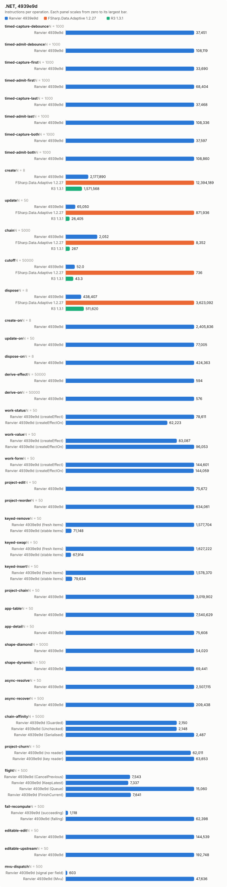
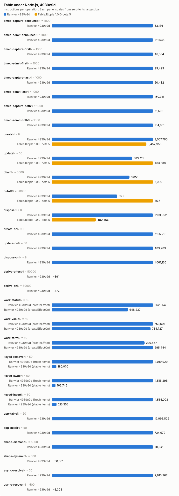

# Counter bench, 4939e9d

- Date: 2026-10-16 02:19:25Z
- Machine: AMD64 Family 26 Model 68 Stepping 0, AuthenticAMD, 24 logical processors, Microsoft Windows 10.0.26200, .NET 10.0.13
- Instructions: per-context-switch PMC counters (InstructionRetired, TotalCycles, BranchMispredictions)
- Library counters: from a separate RanvierCounters build (--counters-worker)
- Versions: .NET 10.0.13, FSharp.Data.Adaptive 1.2.27, R3 1.3.1, Ranvier 4939e9d
- Worker environment: DOTNET_TieredCompilation=0 DOTNET_TieredPGO=0 DOTNET_ReadyToRun=0 DOTNET_gcServer=0
- RanvierTrace: false
- Every figure is (m(2N) - m(N)) / N. Processor counters are the median over runs.
- Instruction counts differing by under 5 % are within run-to-run noise. Compare only reports taken at the same --scale.

## Engine differences

- R3 pushes each write straight to its subscribers, without batching or glitch-free ordering. Its chain is `Select` operators holding no cached value.
- FSharp.Data.Adaptive dispose removes the callback subscriptions only. The `AVal.map2` nodes stay in the weak output sets of their `cval`s until collected.

## timed-capture-debounce: capture a changed input in 64 timed nodes (N = 1000)

| Engine | instr/op | cycles/op | br-miss/op | intervals N/2N | bytes/op | objects/op | counters/op |
| --- | ---: | ---: | ---: | ---: | ---: | ---: | --- |
| Ranvier 4939e9d | 37,451.08 | 13,102.99 | 1.97 | 1/2 | 0 | 0 | MemoRecomputes 64, Flushes 1 |

## timed-admit-debounce: capture and admit in 64 timed nodes (N = 1000)

| Engine | instr/op | cycles/op | br-miss/op | intervals N/2N | bytes/op | objects/op | counters/op |
| --- | ---: | ---: | ---: | ---: | ---: | ---: | --- |
| Ranvier 4939e9d | 108,118.73 | 37,359.31 | 3.67 | 2/1 | 1,536 | 0 | MemoRecomputes 64, EffectRuns 64, Flushes 65 |

## timed-capture-first: capture a changed input in 64 timed nodes (N = 1000)

| Engine | instr/op | cycles/op | br-miss/op | intervals N/2N | bytes/op | objects/op | counters/op |
| --- | ---: | ---: | ---: | ---: | ---: | ---: | --- |
| Ranvier 4939e9d | 33,689.95 | 11,116.80 | 2.28 | 2/2 | 0 | 0 | MemoRecomputes 64, Flushes 1 |

## timed-admit-first: capture and admit in 64 timed nodes (N = 1000)

| Engine | instr/op | cycles/op | br-miss/op | intervals N/2N | bytes/op | objects/op | counters/op |
| --- | ---: | ---: | ---: | ---: | ---: | ---: | --- |
| Ranvier 4939e9d | 68,404.19 | 22,767.35 | 3.21 | 1/2 | 0 | 0 | MemoRecomputes 64, EffectRuns 64, Flushes 1 |

## timed-capture-last: capture a changed input in 64 timed nodes (N = 1000)

| Engine | instr/op | cycles/op | br-miss/op | intervals N/2N | bytes/op | objects/op | counters/op |
| --- | ---: | ---: | ---: | ---: | ---: | ---: | --- |
| Ranvier 4939e9d | 37,467.99 | 12,716.26 | 2.08 | 2/2 | 0 | 0 | MemoRecomputes 64, Flushes 1 |

## timed-admit-last: capture and admit in 64 timed nodes (N = 1000)

| Engine | instr/op | cycles/op | br-miss/op | intervals N/2N | bytes/op | objects/op | counters/op |
| --- | ---: | ---: | ---: | ---: | ---: | ---: | --- |
| Ranvier 4939e9d | 108,335.90 | 38,087.03 | 3.70 | 2/3 | 1,536 | 0 | MemoRecomputes 64, EffectRuns 64, Flushes 65 |

## timed-capture-both: capture a changed input in 64 timed nodes (N = 1000)

| Engine | instr/op | cycles/op | br-miss/op | intervals N/2N | bytes/op | objects/op | counters/op |
| --- | ---: | ---: | ---: | ---: | ---: | ---: | --- |
| Ranvier 4939e9d | 37,597.32 | 13,200.72 | 2.35 | 2/2 | 0 | 0 | MemoRecomputes 64, Flushes 1 |

## timed-admit-both: capture and admit in 64 timed nodes (N = 1000)

| Engine | instr/op | cycles/op | br-miss/op | intervals N/2N | bytes/op | objects/op | counters/op |
| --- | ---: | ---: | ---: | ---: | ---: | ---: | --- |
| Ranvier 4939e9d | 108,860.18 | 38,183.76 | 4.40 | 2/2 | 1,536 | 0 | MemoRecomputes 64, EffectRuns 64, Flushes 65 |

## create: one root of 1000 rows (N = 8)

| Engine | instr/op | cycles/op | br-miss/op | intervals N/2N | bytes/op | objects/op | counters/op |
| --- | ---: | ---: | ---: | ---: | ---: | ---: | --- |
| Ranvier 4939e9d | 2,177,889.62 | 945,525.75 | 1,103 | 2/2 | 594,520 | 2,002 | SignalsCreated 1,001, EffectsCreated 1,000, OwnersCreated 1, EdgesAdded 2,000, ObserverInserts 2,000, EffectRuns 1,000, Flushes 1,000 |
| FSharp.Data.Adaptive 1.2.27 | 12,394,188.88 | 6,026,572.88 | 7,415.38 | 3/2 | 2,413,717 | n/a | n/a |
| R3 1.3.1 | 1,571,568.25 | 763,328.88 | 444.75 | 1/2 | 584,160 | n/a | n/a |

## update: write every 10th of 1000 rows (N = 50)

| Engine | instr/op | cycles/op | br-miss/op | intervals N/2N | bytes/op | objects/op | counters/op |
| --- | ---: | ---: | ---: | ---: | ---: | ---: | --- |
| Ranvier 4939e9d | 65,049.70 | 20,179.86 | -5.52 | 1/2 | 0 | 0 | EffectRuns 100, Flushes 100 |
| FSharp.Data.Adaptive 1.2.27 | 871,936.46 | 369,995.12 | 454.70 | 2/2 | 63,200 | n/a | n/a |
| R3 1.3.1 | 26,404.68 | 12,621.50 | 0.38 | 1/1 | 0 | n/a | n/a |

## chain: write the source of 4 memos, read the tail (N = 5000)

| Engine | instr/op | cycles/op | br-miss/op | intervals N/2N | bytes/op | objects/op | counters/op |
| --- | ---: | ---: | ---: | ---: | ---: | ---: | --- |
| Ranvier 4939e9d | 2,052.16 | 814.00 | 1.05 | 1/1 | 0 | 0 | MemoRecomputes 4 |
| FSharp.Data.Adaptive 1.2.27 | 8,352.32 | 2,976.74 | 1.38 | 2/2 | 472 | n/a | n/a |
| R3 1.3.1 | 267.04 | 164.38 | 0.01 | 1/1 | 0 | n/a | n/a |

## cutoff: write an equal value to an observed source (N = 50000)

| Engine | instr/op | cycles/op | br-miss/op | intervals N/2N | bytes/op | objects/op | counters/op |
| --- | ---: | ---: | ---: | ---: | ---: | ---: | --- |
| Ranvier 4939e9d | 52.00 | 18.98 | -0.00 | 1/2 | 0 | 0 | 0 |
| FSharp.Data.Adaptive 1.2.27 | 736.02 | 370.58 | 0.28 | 1/1 | 352 | n/a | n/a |
| R3 1.3.1 | 43.29 | 25.18 | 0.00 | 1/1 | 0 | n/a | n/a |

## dispose: dispose one root of 1000 rows (N = 8)

| Engine | instr/op | cycles/op | br-miss/op | intervals N/2N | bytes/op | objects/op | counters/op |
| --- | ---: | ---: | ---: | ---: | ---: | ---: | --- |
| Ranvier 4939e9d | 438,406.88 | 128,988.75 | 33.88 | 1/1 | 56 | 0 | EdgesRemoved 2,000, ObserverRemoves 2,000 |
| FSharp.Data.Adaptive 1.2.27 | 3,623,092.25 | 2,720,855 | 3,218.62 | 2/1 | 0 | n/a | n/a |
| R3 1.3.1 | 511,620.38 | 334,357 | 525.88 | 1/1 | 0 | n/a | n/a |

## create-on: one root of 1000 createEffectOn rows (N = 8)

| Engine | instr/op | cycles/op | br-miss/op | intervals N/2N | bytes/op | objects/op | counters/op |
| --- | ---: | ---: | ---: | ---: | ---: | ---: | --- |
| Ranvier 4939e9d | 2,405,835.62 | 797,837.25 | 1,062.25 | 1/1 | 506,664 | 2,002 | SignalsCreated 1,001, EffectsCreated 1,000, OwnersCreated 1, EdgesAdded 2,000, ObserverInserts 2,000, EffectRuns 1,000, Flushes 1,000 |

## update-on: write every 10th of 1000 createEffectOn rows (N = 50)

| Engine | instr/op | cycles/op | br-miss/op | intervals N/2N | bytes/op | objects/op | counters/op |
| --- | ---: | ---: | ---: | ---: | ---: | ---: | --- |
| Ranvier 4939e9d | 77,005 | 22,176.46 | 1.52 | 1/1 | 0 | 0 | EffectRuns 100, Flushes 100 |

## dispose-on: dispose one root of 1000 createEffectOn rows (N = 8)

| Engine | instr/op | cycles/op | br-miss/op | intervals N/2N | bytes/op | objects/op | counters/op |
| --- | ---: | ---: | ---: | ---: | ---: | ---: | --- |
| Ranvier 4939e9d | 424,362.62 | 113,230.88 | 17.12 | 1/1 | 56 | 0 | EdgesRemoved 2,000, ObserverRemoves 2,000 |

## derive-effect: write a new value whose derived value is unchanged, Effect (N = 50000)

| Engine | instr/op | cycles/op | br-miss/op | intervals N/2N | bytes/op | objects/op | counters/op |
| --- | ---: | ---: | ---: | ---: | ---: | ---: | --- |
| Ranvier 4939e9d | 593.90 | 173.28 | 0.00 | 2/1 | 0 | 0 | EffectRuns 1, Flushes 1 |

## derive-on: write a new value whose derived value is unchanged, createEffectOn (N = 50000)

| Engine | instr/op | cycles/op | br-miss/op | intervals N/2N | bytes/op | objects/op | counters/op |
| --- | ---: | ---: | ---: | ---: | ---: | ---: | --- |
| Ranvier 4939e9d | 575.97 | 166.25 | 0.00 | 3/2 | 0 | 0 | EffectRuns 1, Flushes 1 |

## work-status: write every 10th of 1000 rows; the act formats a label, 1 write in 10 changes it (N = 50)

| Engine | instr/op | cycles/op | br-miss/op | intervals N/2N | bytes/op | objects/op | counters/op |
| --- | ---: | ---: | ---: | ---: | ---: | ---: | --- |
| Ranvier 4939e9d (createEffect) | 78,610.66 | 22,313.86 | 5.98 | 1/1 | 3,980 | 0 | EffectRuns 100, Flushes 100 |
| Ranvier 4939e9d (createEffectOn) | 62,223.18 | 16,839.76 | 4.58 | 1/1 | 398.40 | 0 | EffectRuns 100, Flushes 100 |

## work-value: write every 10th of 1000 rows; the act formats a label, every write changes it (N = 50)

| Engine | instr/op | cycles/op | br-miss/op | intervals N/2N | bytes/op | objects/op | counters/op |
| --- | ---: | ---: | ---: | ---: | ---: | ---: | --- |
| Ranvier 4939e9d (createEffect) | 83,087 | 29,985.14 | 8.52 | 1/2 | 6,467.20 | 0 | EffectRuns 100, Flushes 100 |
| Ranvier 4939e9d (createEffectOn) | 96,053.44 | 29,205 | 4.16 | 2/1 | 6,467.20 | 0 | EffectRuns 100, Flushes 100 |

## work-form: write one field of each of 125 8-field forms; validity feeds a signal and an effect (N = 50)

| Engine | instr/op | cycles/op | br-miss/op | intervals N/2N | bytes/op | objects/op | counters/op |
| --- | ---: | ---: | ---: | ---: | ---: | ---: | --- |
| Ranvier 4939e9d (createEffect) | 144,600.76 | 40,148.06 | 25.34 | 5/1 | 0 | 0 | EffectRuns 126.02, Flushes 125 |
| Ranvier 4939e9d (createEffectOn) | 144,059.22 | 37,702.78 | 15.08 | 1/2 | 0 | 0 | EffectRuns 126.02, Flushes 125 |

## project-edit: change one row of a 1000-row projection (N = 50)

| Engine | instr/op | cycles/op | br-miss/op | intervals N/2N | bytes/op | objects/op | counters/op |
| --- | ---: | ---: | ---: | ---: | ---: | ---: | --- |
| Ranvier 4939e9d | 75,671.88 | 22,884.38 | 15.34 | 1/1 | 168 | 0 | MemoRecomputes 1, EffectRuns 1, Flushes 1 |

## project-reorder: reverse a 1000-row projection (N = 50)

| Engine | instr/op | cycles/op | br-miss/op | intervals N/2N | bytes/op | objects/op | counters/op |
| --- | ---: | ---: | ---: | ---: | ---: | ---: | --- |
| Ranvier 4939e9d | 634,061.20 | 219,342.30 | 18.40 | 2/1 | 8,216 | 0 | Flushes 1 |

## keyed-remove: alternately remove and restore the middle row of a 1000-row projection (N = 50)

| Engine | instr/op | cycles/op | br-miss/op | intervals N/2N | bytes/op | objects/op | counters/op |
| --- | ---: | ---: | ---: | ---: | ---: | ---: | --- |
| Ranvier 4939e9d (fresh items) | 1,577,704.10 | 538,865.82 | 50.28 | 3/2 | 8,516 | 1 | SignalsCreated 0.50, MemosCreated 0.50, EdgesAdded 1.50, EdgesRemoved 1.50, ObserverInserts 1.50, ObserverRemoves 1.50, MemoRecomputes 999.50, EffectRuns 3, Flushes 1 |
| Ranvier 4939e9d (stable items) | 71,148.50 | 24,457.06 | 11.72 | 1/1 | 8,516 | 1 | SignalsCreated 0.50, MemosCreated 0.50, EdgesAdded 1.50, EdgesRemoved 1.50, ObserverInserts 1.50, ObserverRemoves 1.50, MemoRecomputes 0.50, EffectRuns 3, Flushes 1 |

## keyed-swap: alternately swap and restore the second and second-to-last rows of a 1000-row projection (N = 50)

| Engine | instr/op | cycles/op | br-miss/op | intervals N/2N | bytes/op | objects/op | counters/op |
| --- | ---: | ---: | ---: | ---: | ---: | ---: | --- |
| Ranvier 4939e9d (fresh items) | 1,627,222.06 | 549,057.52 | 41.98 | 2/1 | 8,216 | 0 | MemoRecomputes 1,000, EffectRuns 2, Flushes 1 |
| Ranvier 4939e9d (stable items) | 67,914.44 | 21,753.68 | 4.34 | 1/1 | 8,216 | 0 | EffectRuns 2, Flushes 1 |

## keyed-insert: alternately prepend a row and restore of a 1000-row projection (N = 50)

| Engine | instr/op | cycles/op | br-miss/op | intervals N/2N | bytes/op | objects/op | counters/op |
| --- | ---: | ---: | ---: | ---: | ---: | ---: | --- |
| Ranvier 4939e9d (fresh items) | 1,578,370.32 | 540,964.74 | 61.64 | 2/2 | 8,524 | 1 | SignalsCreated 0.50, MemosCreated 0.50, EdgesAdded 1.50, EdgesRemoved 1.50, ObserverInserts 1.50, ObserverRemoves 1.50, MemoRecomputes 1,000.50, EffectRuns 2, Flushes 1 |
| Ranvier 4939e9d (stable items) | 79,634 | 22,461.02 | 14.66 | 1/1 | 8,524 | 1 | SignalsCreated 0.50, MemosCreated 0.50, EdgesAdded 1.50, EdgesRemoved 1.50, ObserverInserts 1.50, ObserverRemoves 1.50, MemoRecomputes 0.50, EffectRuns 2, Flushes 1 |

## project-chain: change one row of a 1000-row filter, sortBy, map chain (N = 50)

| Engine | instr/op | cycles/op | br-miss/op | intervals N/2N | bytes/op | objects/op | counters/op |
| --- | ---: | ---: | ---: | ---: | ---: | ---: | --- |
| Ranvier 4939e9d | 3,019,901.66 | 702,927 | 237.60 | 2/2 | 204,944 | 0 | MemoRecomputes 6, EffectRuns 2, Flushes 1 |

## app-table: alternate a filter query and a sort direction over 1000 rows (N = 50)

| Engine | instr/op | cycles/op | br-miss/op | intervals N/2N | bytes/op | objects/op | counters/op |
| --- | ---: | ---: | ---: | ---: | ---: | ---: | --- |
| Ranvier 4939e9d | 7,540,628.58 | 2,359,687.08 | 1,339.90 | 2/4 | 422,480.80 | 240 | SignalsCreated 120, MemosCreated 120, EdgesAdded 760.50, EdgesRemoved 760.50, ObserverInserts 760.50, ObserverRemoves 760.50, MemoRecomputes 980, EffectRuns 1, Flushes 1 |

## app-detail: move the selection over 1000 rows; the detail rebuilds 20 memo and effect pairs (N = 50)

| Engine | instr/op | cycles/op | br-miss/op | intervals N/2N | bytes/op | objects/op | counters/op |
| --- | ---: | ---: | ---: | ---: | ---: | ---: | --- |
| Ranvier 4939e9d | 75,607.86 | 28,829.46 | 43.24 | 1/1 | 12,960 | 40 | MemosCreated 20, EffectsCreated 20, EdgesAdded 41, EdgesRemoved 41, ObserverInserts 41, ObserverRemoves 41, MemoRecomputes 21, EffectRuns 24, Flushes 1 |

## shape-diamond: write a source read by 100 memos joined by one (N = 5000)

| Engine | instr/op | cycles/op | br-miss/op | intervals N/2N | bytes/op | objects/op | counters/op |
| --- | ---: | ---: | ---: | ---: | ---: | ---: | --- |
| Ranvier 4939e9d | 54,020.46 | 17,553.00 | 2.36 | 2/3 | 0 | 0 | MemoRecomputes 101, EffectRuns 1, Flushes 1 |

## shape-dynamic: alternate a branch flip and a write of every active source of 100 effects (N = 500)

| Engine | instr/op | cycles/op | br-miss/op | intervals N/2N | bytes/op | objects/op | counters/op |
| --- | ---: | ---: | ---: | ---: | ---: | ---: | --- |
| Ranvier 4939e9d | 69,441.14 | 19,285.77 | 2.24 | 2/1 | 0 | 0 | EdgesAdded 50, EdgesRemoved 50, ObserverInserts 50, ObserverRemoves 50, EffectRuns 100, Flushes 50.50 |

## async-resolve: reload 10 suspense widgets of 10 sources, then settle each (N = 50)

| Engine | instr/op | cycles/op | br-miss/op | intervals N/2N | bytes/op | objects/op | counters/op |
| --- | ---: | ---: | ---: | ---: | ---: | ---: | --- |
| Ranvier 4939e9d | 2,507,115.30 | 912,467.54 | 1,375.32 | 6/2 | 71,008 | 0 | EdgesAdded 190, EdgesRemoved 190, ObserverInserts 190, ObserverRemoves 190, EffectRuns 20, Flushes 101 |

## async-recover: fail one source of one error-boundary widget, then settle a replacement (N = 500)

| Engine | instr/op | cycles/op | br-miss/op | intervals N/2N | bytes/op | objects/op | counters/op |
| --- | ---: | ---: | ---: | ---: | ---: | ---: | --- |
| Ranvier 4939e9d | 209,438.34 | 172,661.82 | 117.54 | 2/4 | 180,422.29 | 0 | EdgesAdded 20, EdgesRemoved 20, ObserverInserts 20, ObserverRemoves 20, EffectRuns 4, Flushes 4 |

## chain-affinity: write the source of 4 memos, read the tail, per thread affinity (N = 5000)

| Engine | instr/op | cycles/op | br-miss/op | intervals N/2N | bytes/op | objects/op | counters/op |
| --- | ---: | ---: | ---: | ---: | ---: | ---: | --- |
| Ranvier 4939e9d (Guarded) | 2,150.01 | 828.85 | 1.04 | 1/1 | 0 | 0 | MemoRecomputes 4 |
| Ranvier 4939e9d (Unchecked) | 2,148.10 | 817.03 | 0.98 | 1/1 | 0 | 0 | MemoRecomputes 4 |
| Ranvier 4939e9d (Serialised) | 2,486.59 | 893.78 | 0.58 | 2/1 | 0 | 0 | MemoRecomputes 4 |

## project-churn: replace the last key of a 1000-row projection (N = 50)

| Engine | instr/op | cycles/op | br-miss/op | intervals N/2N | bytes/op | objects/op | counters/op |
| --- | ---: | ---: | ---: | ---: | ---: | ---: | --- |
| Ranvier 4939e9d (no reader) | 62,010.82 | 21,184.22 | 9.06 | 2/1 | 8,680 | 2 | SignalsCreated 1, MemosCreated 1, EffectRuns 1, Flushes 1 |
| Ranvier 4939e9d (key reader) | 63,653.22 | 22,268.20 | 26.58 | 1/1 | 9,080 | 2 | SignalsCreated 1, MemosCreated 1, EffectRuns 2, Flushes 1 |

## flight: write an async memo's trigger twice, then settle every flight the writes started (N = 500)

| Engine | instr/op | cycles/op | br-miss/op | intervals N/2N | bytes/op | objects/op | counters/op |
| --- | ---: | ---: | ---: | ---: | ---: | ---: | --- |
| Ranvier 4939e9d (CancelPrevious) | 7,542.68 | 3,094.25 | 0.86 | 2/1 | 1,720 | 0 | 0 |
| Ranvier 4939e9d (KeepLatest) | 7,336.90 | 2,879.03 | 2.28 | 1/2 | 1,672 | 0 | 0 |
| Ranvier 4939e9d (Queue) | 15,060.25 | 5,767.08 | 9.51 | 1/1 | 3,184 | 0 | 0 |
| Ranvier 4939e9d (FinishCurrent) | 7,640.77 | 2,949.08 | 1.11 | 1/1 | 1,744 | 0 | 0 |

## fail-recompute: re-run a memo and its one reader, then read the reader's failure origin (N = 500)

| Engine | instr/op | cycles/op | br-miss/op | intervals N/2N | bytes/op | objects/op | counters/op |
| --- | ---: | ---: | ---: | ---: | ---: | ---: | --- |
| Ranvier 4939e9d (succeeding) | 1,117.78 | 337.25 | -0.06 | 1/1 | 0 | 0 | MemoRecomputes 2 |
| Ranvier 4939e9d (failing) | 62,398.34 | 20,602.83 | 30.79 | 2/2 | 1,576 | 0 | MemoRecomputes 2 |

## editable-edit: edit every 10th of 1000 editables (N = 50)

| Engine | instr/op | cycles/op | br-miss/op | intervals N/2N | bytes/op | objects/op | counters/op |
| --- | ---: | ---: | ---: | ---: | ---: | ---: | --- |
| Ranvier 4939e9d | 144,539.20 | 48,998.56 | 6.68 | 1/2 | 0 | 0 | MemoRecomputes 100, EffectRuns 100, Flushes 100 |

## editable-upstream: write the seed source of every 10th of 1000 editables (N = 50)

| Engine | instr/op | cycles/op | br-miss/op | intervals N/2N | bytes/op | objects/op | counters/op |
| --- | ---: | ---: | ---: | ---: | ---: | ---: | --- |
| Ranvier 4939e9d | 192,748.40 | 61,790.18 | 1.54 | 2/1 | 2,400 | 0 | MemoRecomputes 200, EffectRuns 100, Flushes 100 |

## mvu-dispatch: change one field of a 64-field model, one reader per field (N = 500)

| Engine | instr/op | cycles/op | br-miss/op | intervals N/2N | bytes/op | objects/op | counters/op |
| --- | ---: | ---: | ---: | ---: | ---: | ---: | --- |
| Ranvier 4939e9d (signal per field) | 602.65 | 236.95 | 0.12 | 1/1 | 0 | 0 | EffectRuns 1, Flushes 1 |
| Ranvier 4939e9d (Mvu) | 47,635.70 | 15,535.36 | 4.54 | 3/1 | 400 | 0 | MemoRecomputes 64, EffectRuns 1, Flushes 1 |

## Calibration, 5 run(s)

Allocations and library counters identical in every run.

| Scenario | Engine | Source | Median/op | Min/op | Max/op | Spread |
| --- | --- | --- | ---: | ---: | ---: | ---: |
| timed-capture-debounce | Ranvier | InstructionRetired | 37,451.08 | 37,353.39 | 37,509.39 | 0.42 % |
| timed-capture-debounce | Ranvier | TotalCycles | 13,102.99 | 12,535.75 | 13,341.34 | 6.43 % |
| timed-capture-debounce | Ranvier | BranchMispredictions | 1.97 | 1.60 | 2.76 | 71.93 % |
| timed-admit-debounce | Ranvier | InstructionRetired | 108,118.73 | 108,055.78 | 108,239.15 | 0.17 % |
| timed-admit-debounce | Ranvier | TotalCycles | 37,359.31 | 34,975.99 | 38,186.29 | 9.18 % |
| timed-admit-debounce | Ranvier | BranchMispredictions | 3.67 | 3.07 | 6.75 | 119.88 % |
| timed-capture-first | Ranvier | InstructionRetired | 33,689.95 | 33,680.50 | 33,702.25 | 0.06 % |
| timed-capture-first | Ranvier | TotalCycles | 11,116.80 | 10,882.38 | 11,379.80 | 4.57 % |
| timed-capture-first | Ranvier | BranchMispredictions | 2.28 | 2.04 | 2.96 | 45.15 % |
| timed-admit-first | Ranvier | InstructionRetired | 68,404.19 | 68,381.11 | 68,507.85 | 0.19 % |
| timed-admit-first | Ranvier | TotalCycles | 22,767.35 | 22,387.01 | 22,817.81 | 1.92 % |
| timed-admit-first | Ranvier | BranchMispredictions | 3.21 | 1.99 | 5.33 | 167.87 % |
| timed-capture-last | Ranvier | InstructionRetired | 37,467.99 | 37,453.51 | 37,494.83 | 0.11 % |
| timed-capture-last | Ranvier | TotalCycles | 12,716.26 | 12,676.10 | 12,942.34 | 2.10 % |
| timed-capture-last | Ranvier | BranchMispredictions | 2.08 | 1.97 | 2.34 | 19.06 % |
| timed-admit-last | Ranvier | InstructionRetired | 108,335.90 | 108,244.12 | 108,399.62 | 0.14 % |
| timed-admit-last | Ranvier | TotalCycles | 38,087.03 | 37,373.12 | 38,604.13 | 3.29 % |
| timed-admit-last | Ranvier | BranchMispredictions | 3.70 | 3.36 | 4.21 | 25.15 % |
| timed-capture-both | Ranvier | InstructionRetired | 37,597.32 | 37,586.69 | 37,638.53 | 0.14 % |
| timed-capture-both | Ranvier | TotalCycles | 13,200.72 | 8,754.17 | 13,445.63 | 53.59 % |
| timed-capture-both | Ranvier | BranchMispredictions | 2.35 | 1.83 | 2.74 | 49.73 % |
| timed-admit-both | Ranvier | InstructionRetired | 108,860.18 | 108,806.92 | 108,918.38 | 0.10 % |
| timed-admit-both | Ranvier | TotalCycles | 38,183.76 | 37,314.52 | 39,289.81 | 5.29 % |
| timed-admit-both | Ranvier | BranchMispredictions | 4.40 | 3.68 | 6.84 | 85.86 % |
| create | Ranvier | InstructionRetired | 2,177,889.62 | 2,175,782.50 | 2,229,583 | 2.47 % |
| create | Ranvier | TotalCycles | 945,525.75 | 663,853.25 | 1,295,569.62 | 95.16 % |
| create | Ranvier | BranchMispredictions | 1,103 | 846 | 1,265.62 | 49.60 % |
| create | FSharp.Data.Adaptive | InstructionRetired | 12,394,188.88 | 12,378,407.50 | 12,452,401.75 | 0.60 % |
| create | FSharp.Data.Adaptive | TotalCycles | 6,026,572.88 | 5,740,488.88 | 6,047,032.75 | 5.34 % |
| create | FSharp.Data.Adaptive | BranchMispredictions | 7,415.38 | 6,701.12 | 8,686.88 | 29.63 % |
| create | R3 | InstructionRetired | 1,571,568.25 | 1,570,985.75 | 1,587,676 | 1.06 % |
| create | R3 | TotalCycles | 763,328.88 | 690,539.38 | 822,785.88 | 19.15 % |
| create | R3 | BranchMispredictions | 444.75 | 405.75 | 665.12 | 63.92 % |
| update | Ranvier | InstructionRetired | 65,049.70 | 64,900.24 | 65,617.58 | 1.11 % |
| update | Ranvier | TotalCycles | 20,179.86 | 16,983.06 | 24,513.08 | 44.34 % |
| update | Ranvier | BranchMispredictions | -5.52 | -8.74 | 11.08 | -226.77 % |
| update | FSharp.Data.Adaptive | InstructionRetired | 871,936.46 | 871,517.74 | 874,515.24 | 0.34 % |
| update | FSharp.Data.Adaptive | TotalCycles | 369,995.12 | 367,187.38 | 387,881.68 | 5.64 % |
| update | FSharp.Data.Adaptive | BranchMispredictions | 454.70 | 390.76 | 537.64 | 37.59 % |
| update | R3 | InstructionRetired | 26,404.68 | 26,402.26 | 26,410.30 | 0.03 % |
| update | R3 | TotalCycles | 12,621.50 | 9,996.86 | 13,937.30 | 39.42 % |
| update | R3 | BranchMispredictions | 0.38 | -3.32 | 1.80 | -154.22 % |
| chain | Ranvier | InstructionRetired | 2,052.16 | 2,049.48 | 2,085.38 | 1.75 % |
| chain | Ranvier | TotalCycles | 814.00 | 789.50 | 1,192.85 | 51.09 % |
| chain | Ranvier | BranchMispredictions | 1.05 | 0.85 | 1.69 | 97.75 % |
| chain | FSharp.Data.Adaptive | InstructionRetired | 8,352.32 | 8,341.22 | 8,367.31 | 0.31 % |
| chain | FSharp.Data.Adaptive | TotalCycles | 2,976.74 | 2,896.92 | 3,196.07 | 10.33 % |
| chain | FSharp.Data.Adaptive | BranchMispredictions | 1.38 | 1.29 | 1.66 | 28.44 % |
| chain | R3 | InstructionRetired | 267.04 | 266.82 | 268.32 | 0.56 % |
| chain | R3 | TotalCycles | 164.38 | 154.94 | 191.63 | 23.68 % |
| chain | R3 | BranchMispredictions | 0.01 | -0.02 | 0.04 | -283.76 % |
| cutoff | Ranvier | InstructionRetired | 52.00 | 51.85 | 52.12 | 0.53 % |
| cutoff | Ranvier | TotalCycles | 18.98 | 15.96 | 19.58 | 22.68 % |
| cutoff | Ranvier | BranchMispredictions | -0.00 | -0.00 | 0.00 | -102.46 % |
| cutoff | FSharp.Data.Adaptive | InstructionRetired | 736.02 | 734.41 | 737.01 | 0.35 % |
| cutoff | FSharp.Data.Adaptive | TotalCycles | 370.58 | 349.14 | 432.48 | 23.87 % |
| cutoff | FSharp.Data.Adaptive | BranchMispredictions | 0.28 | 0.25 | 0.29 | 12.94 % |
| cutoff | R3 | InstructionRetired | 43.29 | 42.75 | 43.38 | 1.46 % |
| cutoff | R3 | TotalCycles | 25.18 | 23.09 | 26.66 | 15.45 % |
| cutoff | R3 | BranchMispredictions | 0.00 | -0.01 | 0.01 | -194.37 % |
| dispose | Ranvier | InstructionRetired | 438,406.88 | 437,400.25 | 439,869.12 | 0.56 % |
| dispose | Ranvier | TotalCycles | 128,988.75 | 107,492.38 | 193,776 | 80.27 % |
| dispose | Ranvier | BranchMispredictions | 33.88 | -4.38 | 68 | -1,654.29 % |
| dispose | FSharp.Data.Adaptive | InstructionRetired | 3,623,092.25 | 3,619,490 | 3,626,228.62 | 0.19 % |
| dispose | FSharp.Data.Adaptive | TotalCycles | 2,720,855 | 2,692,726.62 | 3,130,872.12 | 16.27 % |
| dispose | FSharp.Data.Adaptive | BranchMispredictions | 3,218.62 | 3,164.12 | 3,353.50 | 5.99 % |
| dispose | R3 | InstructionRetired | 511,620.38 | 509,859.88 | 513,966.62 | 0.81 % |
| dispose | R3 | TotalCycles | 334,357 | 310,900.50 | 415,284 | 33.57 % |
| dispose | R3 | BranchMispredictions | 525.88 | 451.62 | 579.25 | 28.26 % |
| create-on | Ranvier | InstructionRetired | 2,405,835.62 | 2,404,107.38 | 2,407,662.62 | 0.15 % |
| create-on | Ranvier | TotalCycles | 797,837.25 | 625,853.50 | 940,843.62 | 50.33 % |
| create-on | Ranvier | BranchMispredictions | 1,062.25 | 977.75 | 1,189 | 21.61 % |
| update-on | Ranvier | InstructionRetired | 77,005 | 76,680.54 | 77,189.78 | 0.66 % |
| update-on | Ranvier | TotalCycles | 22,176.46 | 20,256.46 | 28,575.22 | 41.07 % |
| update-on | Ranvier | BranchMispredictions | 1.52 | -8.86 | 6.30 | -171.11 % |
| dispose-on | Ranvier | InstructionRetired | 424,362.62 | 422,887.50 | 424,917.38 | 0.48 % |
| dispose-on | Ranvier | TotalCycles | 113,230.88 | 99,016 | 140,776.88 | 42.18 % |
| dispose-on | Ranvier | BranchMispredictions | 17.12 | -16.62 | 50.12 | -401.50 % |
| derive-effect | Ranvier | InstructionRetired | 593.90 | 592.74 | 594.44 | 0.29 % |
| derive-effect | Ranvier | TotalCycles | 173.28 | 159.01 | 184.72 | 16.17 % |
| derive-effect | Ranvier | BranchMispredictions | 0.00 | -0.03 | 0.01 | -133.93 % |
| derive-on | Ranvier | InstructionRetired | 575.97 | 575.63 | 576.56 | 0.16 % |
| derive-on | Ranvier | TotalCycles | 166.25 | 163.78 | 179.90 | 9.84 % |
| derive-on | Ranvier | BranchMispredictions | 0.00 | -0.01 | 0.01 | -239.06 % |
| work-status | Ranvier (createEffect) | InstructionRetired | 78,610.66 | 78,326.94 | 79,045 | 0.92 % |
| work-status | Ranvier (createEffect) | TotalCycles | 22,313.86 | 19,979.52 | 30,717.98 | 53.75 % |
| work-status | Ranvier (createEffect) | BranchMispredictions | 5.98 | -3.38 | 14.64 | -533.14 % |
| work-status | Ranvier (createEffectOn) | InstructionRetired | 62,223.18 | 61,744.46 | 62,589.22 | 1.37 % |
| work-status | Ranvier (createEffectOn) | TotalCycles | 16,839.76 | 13,695.12 | 30,951.86 | 126.01 % |
| work-status | Ranvier (createEffectOn) | BranchMispredictions | 4.58 | -3.94 | 11.32 | -387.31 % |
| work-value | Ranvier (createEffect) | InstructionRetired | 83,087 | 82,710.72 | 86,250.18 | 4.28 % |
| work-value | Ranvier (createEffect) | TotalCycles | 29,985.14 | 21,940.18 | 41,449.28 | 88.92 % |
| work-value | Ranvier (createEffect) | BranchMispredictions | 8.52 | -1.80 | 88.10 | -4,994.44 % |
| work-value | Ranvier (createEffectOn) | InstructionRetired | 96,053.44 | 95,450.74 | 96,244.28 | 0.83 % |
| work-value | Ranvier (createEffectOn) | TotalCycles | 29,205 | 27,435.12 | 33,544.40 | 22.27 % |
| work-value | Ranvier (createEffectOn) | BranchMispredictions | 4.16 | -10.64 | 10.92 | -202.63 % |
| work-form | Ranvier (createEffect) | InstructionRetired | 144,600.76 | 144,203.58 | 144,800.50 | 0.41 % |
| work-form | Ranvier (createEffect) | TotalCycles | 40,148.06 | 35,114.54 | 48,189.70 | 37.24 % |
| work-form | Ranvier (createEffect) | BranchMispredictions | 25.34 | 6.02 | 30.58 | 407.97 % |
| work-form | Ranvier (createEffectOn) | InstructionRetired | 144,059.22 | 143,928.04 | 146,817.90 | 2.01 % |
| work-form | Ranvier (createEffectOn) | TotalCycles | 37,702.78 | 34,730.88 | 76,463.70 | 120.16 % |
| work-form | Ranvier (createEffectOn) | BranchMispredictions | 15.08 | 12.74 | 52.02 | 308.32 % |
| project-edit | Ranvier | InstructionRetired | 75,671.88 | 75,297.74 | 75,701.16 | 0.54 % |
| project-edit | Ranvier | TotalCycles | 22,884.38 | 15,526.82 | 24,839.44 | 59.98 % |
| project-edit | Ranvier | BranchMispredictions | 15.34 | 10.62 | 25.76 | 142.56 % |
| project-reorder | Ranvier | InstructionRetired | 634,061.20 | 633,122.02 | 634,738.92 | 0.26 % |
| project-reorder | Ranvier | TotalCycles | 219,342.30 | 203,145.82 | 222,442.12 | 9.50 % |
| project-reorder | Ranvier | BranchMispredictions | 18.40 | -15.76 | 26.38 | -267.39 % |
| keyed-remove | Ranvier (fresh items) | InstructionRetired | 1,577,704.10 | 1,576,664.64 | 1,579,369.84 | 0.17 % |
| keyed-remove | Ranvier (fresh items) | TotalCycles | 538,865.82 | 526,695.32 | 549,080.52 | 4.25 % |
| keyed-remove | Ranvier (fresh items) | BranchMispredictions | 50.28 | -6.12 | 76.16 | -1,344.44 % |
| keyed-remove | Ranvier (stable items) | InstructionRetired | 71,148.50 | 70,687.82 | 71,158.96 | 0.67 % |
| keyed-remove | Ranvier (stable items) | TotalCycles | 24,457.06 | 16,142 | 26,993.30 | 67.22 % |
| keyed-remove | Ranvier (stable items) | BranchMispredictions | 11.72 | 5.26 | 27 | 413.31 % |
| keyed-swap | Ranvier (fresh items) | InstructionRetired | 1,627,222.06 | 1,625,366.54 | 1,628,077.88 | 0.17 % |
| keyed-swap | Ranvier (fresh items) | TotalCycles | 549,057.52 | 538,728.04 | 558,850.30 | 3.74 % |
| keyed-swap | Ranvier (fresh items) | BranchMispredictions | 41.98 | -2.28 | 89.44 | -4,022.81 % |
| keyed-swap | Ranvier (stable items) | InstructionRetired | 67,914.44 | 67,763.88 | 67,927 | 0.24 % |
| keyed-swap | Ranvier (stable items) | TotalCycles | 21,753.68 | 16,807.84 | 25,757.98 | 53.25 % |
| keyed-swap | Ranvier (stable items) | BranchMispredictions | 4.34 | -8.98 | 24.88 | -377.06 % |
| keyed-insert | Ranvier (fresh items) | InstructionRetired | 1,578,370.32 | 1,578,010.94 | 1,581,193.78 | 0.20 % |
| keyed-insert | Ranvier (fresh items) | TotalCycles | 540,964.74 | 521,435.48 | 550,843.08 | 5.64 % |
| keyed-insert | Ranvier (fresh items) | BranchMispredictions | 61.64 | 28.08 | 108.50 | 286.40 % |
| keyed-insert | Ranvier (stable items) | InstructionRetired | 79,634 | 79,551.96 | 80,677.60 | 1.41 % |
| keyed-insert | Ranvier (stable items) | TotalCycles | 22,461.02 | 20,057.76 | 29,284.20 | 46.00 % |
| keyed-insert | Ranvier (stable items) | BranchMispredictions | 14.66 | -11.52 | 34 | -395.14 % |
| project-chain | Ranvier | InstructionRetired | 3,019,901.66 | 3,019,000.68 | 3,061,257.28 | 1.40 % |
| project-chain | Ranvier | TotalCycles | 702,927 | 669,184.86 | 761,836.86 | 13.85 % |
| project-chain | Ranvier | BranchMispredictions | 237.60 | 127.16 | 289.02 | 127.29 % |
| app-table | Ranvier | InstructionRetired | 7,540,628.58 | 7,519,317.82 | 7,541,562.66 | 0.30 % |
| app-table | Ranvier | TotalCycles | 2,359,687.08 | 2,226,186.28 | 2,385,262.60 | 7.15 % |
| app-table | Ranvier | BranchMispredictions | 1,339.90 | 1,188.50 | 1,451.48 | 22.13 % |
| app-detail | Ranvier | InstructionRetired | 75,607.86 | 74,975.02 | 76,232.20 | 1.68 % |
| app-detail | Ranvier | TotalCycles | 28,829.46 | 18,354.38 | 38,471.04 | 109.60 % |
| app-detail | Ranvier | BranchMispredictions | 43.24 | 18.50 | 45.22 | 144.43 % |
| shape-diamond | Ranvier | InstructionRetired | 54,020.46 | 53,958.20 | 54,025.52 | 0.12 % |
| shape-diamond | Ranvier | TotalCycles | 17,553.00 | 17,234.26 | 17,765.99 | 3.09 % |
| shape-diamond | Ranvier | BranchMispredictions | 2.36 | 1.88 | 3.12 | 65.54 % |
| shape-dynamic | Ranvier | InstructionRetired | 69,441.14 | 68,860.28 | 69,513.46 | 0.95 % |
| shape-dynamic | Ranvier | TotalCycles | 19,285.77 | 16,975.83 | 21,105.38 | 24.33 % |
| shape-dynamic | Ranvier | BranchMispredictions | 2.24 | -7.11 | 4.64 | -165.20 % |
| async-resolve | Ranvier | InstructionRetired | 2,507,115.30 | 2,505,424.18 | 2,507,598.76 | 0.09 % |
| async-resolve | Ranvier | TotalCycles | 912,467.54 | 869,083.96 | 937,943.78 | 7.92 % |
| async-resolve | Ranvier | BranchMispredictions | 1,375.32 | 1,352.50 | 1,418.96 | 4.91 % |
| async-recover | Ranvier | InstructionRetired | 209,438.34 | 209,044.25 | 209,484.02 | 0.21 % |
| async-recover | Ranvier | TotalCycles | 172,661.82 | 171,546.51 | 177,663.71 | 3.57 % |
| async-recover | Ranvier | BranchMispredictions | 117.54 | 109.40 | 121.28 | 10.86 % |
| chain-affinity | Ranvier (Guarded) | InstructionRetired | 2,150.01 | 2,109.24 | 2,153.53 | 2.10 % |
| chain-affinity | Ranvier (Guarded) | TotalCycles | 828.85 | 294.16 | 847.14 | 187.98 % |
| chain-affinity | Ranvier (Guarded) | BranchMispredictions | 1.04 | -0.49 | 1.72 | -454.48 % |
| chain-affinity | Ranvier (Unchecked) | InstructionRetired | 2,148.10 | 2,145.88 | 2,150.85 | 0.23 % |
| chain-affinity | Ranvier (Unchecked) | TotalCycles | 817.03 | 767.71 | 840.43 | 9.47 % |
| chain-affinity | Ranvier (Unchecked) | BranchMispredictions | 0.98 | 0.35 | 2.12 | 501.87 % |
| chain-affinity | Ranvier (Serialised) | InstructionRetired | 2,486.59 | 2,480.57 | 2,491.92 | 0.46 % |
| chain-affinity | Ranvier (Serialised) | TotalCycles | 893.78 | 866.24 | 958.69 | 10.67 % |
| chain-affinity | Ranvier (Serialised) | BranchMispredictions | 0.58 | 0.33 | 1.67 | 409.95 % |
| project-churn | Ranvier (no reader) | InstructionRetired | 62,010.82 | 61,858.90 | 62,801.34 | 1.52 % |
| project-churn | Ranvier (no reader) | TotalCycles | 21,184.22 | 20,025.34 | 26,118.36 | 30.43 % |
| project-churn | Ranvier (no reader) | BranchMispredictions | 9.06 | 3.82 | 38.24 | 901.05 % |
| project-churn | Ranvier (key reader) | InstructionRetired | 63,653.22 | 63,366.36 | 66,957.22 | 5.67 % |
| project-churn | Ranvier (key reader) | TotalCycles | 22,268.20 | 21,369.10 | 61,995.66 | 190.12 % |
| project-churn | Ranvier (key reader) | BranchMispredictions | 26.58 | -3.66 | 49.76 | -1,459.56 % |
| flight | Ranvier (CancelPrevious) | InstructionRetired | 7,542.68 | 7,487.84 | 7,585.51 | 1.30 % |
| flight | Ranvier (CancelPrevious) | TotalCycles | 3,094.25 | 2,081.29 | 3,938.41 | 89.23 % |
| flight | Ranvier (CancelPrevious) | BranchMispredictions | 0.86 | 0.26 | 2.87 | 987.88 % |
| flight | Ranvier (KeepLatest) | InstructionRetired | 7,336.90 | 7,336.80 | 7,397.37 | 0.83 % |
| flight | Ranvier (KeepLatest) | TotalCycles | 2,879.03 | 2,179.09 | 2,944.47 | 35.12 % |
| flight | Ranvier (KeepLatest) | BranchMispredictions | 2.28 | -0.18 | 3.10 | -1,804.40 % |
| flight | Ranvier (Queue) | InstructionRetired | 15,060.25 | 15,029.65 | 15,080.54 | 0.34 % |
| flight | Ranvier (Queue) | TotalCycles | 5,767.08 | 4,293.93 | 6,250.35 | 45.56 % |
| flight | Ranvier (Queue) | BranchMispredictions | 9.51 | 6.85 | 12.70 | 85.51 % |
| flight | Ranvier (FinishCurrent) | InstructionRetired | 7,640.77 | 7,546.82 | 7,671.06 | 1.65 % |
| flight | Ranvier (FinishCurrent) | TotalCycles | 2,949.08 | 2,590.41 | 5,043.22 | 94.69 % |
| flight | Ranvier (FinishCurrent) | BranchMispredictions | 1.11 | 0.62 | 3.45 | 460.39 % |
| fail-recompute | Ranvier (succeeding) | InstructionRetired | 1,117.78 | 1,113.84 | 1,120.87 | 0.63 % |
| fail-recompute | Ranvier (succeeding) | TotalCycles | 337.25 | 217.16 | 525.98 | 142.21 % |
| fail-recompute | Ranvier (succeeding) | BranchMispredictions | -0.06 | -0.55 | 0.32 | -158.39 % |
| fail-recompute | Ranvier (failing) | InstructionRetired | 62,398.34 | 62,274.39 | 62,426.54 | 0.24 % |
| fail-recompute | Ranvier (failing) | TotalCycles | 20,602.83 | 11,183.99 | 21,285.38 | 90.32 % |
| fail-recompute | Ranvier (failing) | BranchMispredictions | 30.79 | 25.66 | 36.68 | 42.95 % |
| editable-edit | Ranvier | InstructionRetired | 144,539.20 | 144,026.52 | 145,087.98 | 0.74 % |
| editable-edit | Ranvier | TotalCycles | 48,998.56 | 41,227.06 | 54,258.14 | 31.61 % |
| editable-edit | Ranvier | BranchMispredictions | 6.68 | -2.34 | 22.42 | -1,058.12 % |
| editable-upstream | Ranvier | InstructionRetired | 192,748.40 | 192,207.84 | 193,110.24 | 0.47 % |
| editable-upstream | Ranvier | TotalCycles | 61,790.18 | 59,375.68 | 71,518.50 | 20.45 % |
| editable-upstream | Ranvier | BranchMispredictions | 1.54 | -7.96 | 13.86 | -274.12 % |
| mvu-dispatch | Ranvier (signal per field) | InstructionRetired | 602.65 | 594.76 | 616.13 | 3.59 % |
| mvu-dispatch | Ranvier (signal per field) | TotalCycles | 236.95 | 111.23 | 481.51 | 332.91 % |
| mvu-dispatch | Ranvier (signal per field) | BranchMispredictions | 0.12 | -0.32 | 0.45 | -238.89 % |
| mvu-dispatch | Ranvier (Mvu) | InstructionRetired | 47,635.70 | 47,634.32 | 47,788.69 | 0.32 % |
| mvu-dispatch | Ranvier (Mvu) | TotalCycles | 15,535.36 | 15,295.79 | 17,813.77 | 16.46 % |
| mvu-dispatch | Ranvier (Mvu) | BranchMispredictions | 4.54 | 0.87 | 6.51 | 646.10 % |

# Fable under Node.js v26.7.0

- Versions: Fable.Ripple 1.0.0-beta.5, Node.js v26.7.0, Ranvier 4939e9d, fable-library-js 5.18.0
- node flags: --expose-gc --single-threaded
- Instructions: per-context-switch PMC counters (InstructionRetired, TotalCycles, BranchMispredictions); main: the main thread, all: every thread of the process
- bytes/op: growth of the new, old and large-object heap spaces; median of 5 processes. bytes range: minimum..maximum, 0 when every process agreed.
- heapUsed/op: growth of `process.memoryUsage().heapUsed`, which adds the code and trusted spaces.
- Every figure is (m(2N) - m(N)) / N. A figure followed by a bracketed range differed between processes.

## timed-capture-debounce: capture a changed input in 64 timed nodes (N = 1000)

| Engine | instr/op main | instr/op all | cycles/op main | cycles/op all | br-miss/op main | br-miss/op all | bytes/op | bytes range | heapUsed/op | objects/op | counters/op |
| --- | ---: | ---: | ---: | ---: | ---: | ---: | ---: | ---: | ---: | ---: | --- |
| Ranvier 4939e9d | 53,136.37 (52,794.21..53,237.04) | 53,136.37 (52,794.21..53,237.04) | 9,851.80 (6,692.78..10,633.44) | 9,851.80 (6,692.78..10,633.44) | 1.94 (-0.94..2.99) | 1.94 (-0.94..2.99) | -2.37 | 0 | -13.90 | 0 | MemoRecomputes 64, Flushes 1 |

## timed-admit-debounce: capture and admit in 64 timed nodes (N = 1000)

| Engine | instr/op main | instr/op all | cycles/op main | cycles/op all | br-miss/op main | br-miss/op all | bytes/op | bytes range | heapUsed/op | objects/op | counters/op |
| --- | ---: | ---: | ---: | ---: | ---: | ---: | ---: | ---: | ---: | ---: | --- |
| Ranvier 4939e9d | 161,544.57 (61,317.87..161,569.50) | 161,586.80 (61,342.52..161,614.06) | 30,559.37 (-34,114.23..32,027.92) | 30,646.18 (-33,936.58..32,139.77) | 7.79 (-350.00..11.29) | 8.32 (-349.31..12.00) | -575.44 (GC in region) | 0 | -575.44 | 0 | MemoRecomputes 64, EffectRuns 64, Flushes 65 |

## timed-capture-first: capture a changed input in 64 timed nodes (N = 1000)

| Engine | instr/op main | instr/op all | cycles/op main | cycles/op all | br-miss/op main | br-miss/op all | bytes/op | bytes range | heapUsed/op | objects/op | counters/op |
| --- | ---: | ---: | ---: | ---: | ---: | ---: | ---: | ---: | ---: | ---: | --- |
| Ranvier 4939e9d | 46,584.22 (46,563.99..46,615.17) | 46,584.22 (46,563.99..46,615.17) | 9,426.83 (9,106.28..9,877.90) | 9,426.83 (9,106.28..9,877.90) | 2.19 (1.77..2.56) | 2.19 (1.77..2.56) | -0.13 | 0 | -0.23 | 0 | MemoRecomputes 64, Flushes 1 |

## timed-admit-first: capture and admit in 64 timed nodes (N = 1000)

| Engine | instr/op main | instr/op all | cycles/op main | cycles/op all | br-miss/op main | br-miss/op all | bytes/op | bytes range | heapUsed/op | objects/op | counters/op |
| --- | ---: | ---: | ---: | ---: | ---: | ---: | ---: | ---: | ---: | ---: | --- |
| Ranvier 4939e9d | 99,428.87 (99,308.73..99,463.90) | 99,428.87 (99,308.73..99,463.90) | 22,453.56 (20,110.02..37,608.46) | 22,453.56 (20,110.02..37,608.46) | 3.35 (2.15..12.56) | 3.35 (2.15..12.56) | 0 | 0 | 0 | 0 | MemoRecomputes 64, EffectRuns 64, Flushes 1 |

## timed-capture-last: capture a changed input in 64 timed nodes (N = 1000)

| Engine | instr/op main | instr/op all | cycles/op main | cycles/op all | br-miss/op main | br-miss/op all | bytes/op | bytes range | heapUsed/op | objects/op | counters/op |
| --- | ---: | ---: | ---: | ---: | ---: | ---: | ---: | ---: | ---: | ---: | --- |
| Ranvier 4939e9d | 50,431.70 (50,386.32..50,457.69) | 50,431.70 (50,386.32..50,457.69) | 10,883.66 (1,647.99..12,235.42) | 10,883.66 (1,647.99..12,235.42) | 2.36 (2.02..2.44) | 2.36 (2.02..2.44) | 0.35 | 0 | 9.79 | 0 | MemoRecomputes 64, Flushes 1 |

## timed-admit-last: capture and admit in 64 timed nodes (N = 1000)

| Engine | instr/op main | instr/op all | cycles/op main | cycles/op all | br-miss/op main | br-miss/op all | bytes/op | bytes range | heapUsed/op | objects/op | counters/op |
| --- | ---: | ---: | ---: | ---: | ---: | ---: | ---: | ---: | ---: | ---: | --- |
| Ranvier 4939e9d | 160,317.70 (160,261.14..160,363.27) | 160,317.70 (160,261.14..160,363.27) | 30,169.65 (29,940.43..31,980.50) | 30,169.65 (29,940.43..31,980.50) | 4.77 (2.45..7.40) | 4.77 (2.45..7.40) | 3,584.67 | 0 | 3,584.67 | 0 | MemoRecomputes 64, EffectRuns 64, Flushes 65 |

## timed-capture-both: capture a changed input in 64 timed nodes (N = 1000)

| Engine | instr/op main | instr/op all | cycles/op main | cycles/op all | br-miss/op main | br-miss/op all | bytes/op | bytes range | heapUsed/op | objects/op | counters/op |
| --- | ---: | ---: | ---: | ---: | ---: | ---: | ---: | ---: | ---: | ---: | --- |
| Ranvier 4939e9d | 51,593.21 (51,340.27..51,773.84) | 51,593.21 (51,340.27..51,773.84) | 9,146.63 (8,582.54..9,635.73) | 9,146.63 (8,582.54..9,635.73) | 2.96 (0.61..5.26) | 2.96 (0.61..5.26) | 0 | 0 | 0 | 0 | MemoRecomputes 64, Flushes 1 |

## timed-admit-both: capture and admit in 64 timed nodes (N = 1000)

| Engine | instr/op main | instr/op all | cycles/op main | cycles/op all | br-miss/op main | br-miss/op all | bytes/op | bytes range | heapUsed/op | objects/op | counters/op |
| --- | ---: | ---: | ---: | ---: | ---: | ---: | ---: | ---: | ---: | ---: | --- |
| Ranvier 4939e9d | 164,661.20 (164,633.54..164,803.86) | 164,661.20 (164,633.54..164,803.86) | 32,613.33 (30,838.85..33,523.08) | 32,613.33 (30,838.85..33,523.08) | 4.80 (1.87..8.38) | 4.80 (1.87..8.38) | 3,584.62 | 0 | 3,586.12 | 0 | MemoRecomputes 64, EffectRuns 64, Flushes 65 |

## create: one root of 1000 rows (N = 8)

| Engine | instr/op main | instr/op all | cycles/op main | cycles/op all | br-miss/op main | br-miss/op all | bytes/op | bytes range | heapUsed/op | objects/op | counters/op |
| --- | ---: | ---: | ---: | ---: | ---: | ---: | ---: | ---: | ---: | ---: | --- |
| Ranvier 4939e9d | 9,057,759.50 (8,958,068.50..14,387,083.12) | 9,057,759.50 (8,958,068.50..14,387,083.12) | 3,504,616 (3,286,024.75..5,834,352.38) | 3,504,616 (3,286,024.75..5,834,352.38) | 14,376.12 (14,016.25..40,216.88) | 14,376.12 (14,016.25..40,216.88) | 981,958 | 981,958..1,030,199 | 985,132 (985,132..1,034,398) | 2,002 | SignalsCreated 1,001, EffectsCreated 1,000, OwnersCreated 1, EdgesAdded 2,000, ObserverInserts 2,000, EffectRuns 1,000, Flushes 1,000 |
| Fable.Ripple 1.0.0-beta.5 | 8,452,954.75 (8,410,632..11,360,421) | 8,452,954.75 (8,410,632..11,360,421) | 5,690,406.25 (5,003,585..6,693,077.62) | 5,690,406.25 (5,003,585..6,693,077.62) | 67,794 (65,766.25..69,563.12) | 67,794 (65,766.25..69,563.12) | 1,336,451 | 1,336,451..1,435,380 | 1,342,901 (1,342,893..1,441,833) | n/a | n/a |

## update: write every 10th of 1000 rows (N = 50)

| Engine | instr/op main | instr/op all | cycles/op main | cycles/op all | br-miss/op main | br-miss/op all | bytes/op | bytes range | heapUsed/op | objects/op | counters/op |
| --- | ---: | ---: | ---: | ---: | ---: | ---: | ---: | ---: | ---: | ---: | --- |
| Ranvier 4939e9d | 383,411.06 (383,153.12..385,181.68) | 383,411.06 (383,153.12..385,181.68) | 61,788.74 (44,400.44..89,399.54) | 61,788.74 (44,400.44..89,399.54) | -104.44 (-168.88..-68.76) | -104.44 (-168.88..-68.76) | 8,812.48 | 0 | 8,702.08 | 0 | EffectRuns 100, Flushes 100 |
| Fable.Ripple 1.0.0-beta.5 | 483,538.32 (483,317.84..483,680.40) | 483,538.32 (483,317.84..483,680.40) | 83,815.30 (73,353.92..102,584.78) | 83,815.30 (73,353.92..102,584.78) | -62.06 (-170.66..-27.72) | -62.06 (-170.66..-27.72) | 24,019.52 | 0 | 24,188.80 | n/a | n/a |

## chain: write the source of 4 memos, read the tail (N = 5000)

| Engine | instr/op main | instr/op all | cycles/op main | cycles/op all | br-miss/op main | br-miss/op all | bytes/op | bytes range | heapUsed/op | objects/op | counters/op |
| --- | ---: | ---: | ---: | ---: | ---: | ---: | ---: | ---: | ---: | ---: | --- |
| Ranvier 4939e9d | 3,855.50 (3,853.38..3,858.83) | 3,855.50 (3,853.38..3,858.83) | 591.53 (-193.20..1,559.36) | 591.53 (-193.20..1,559.36) | 0.04 (-0.06..0.16) | 0.04 (-0.06..0.16) | 0 | 0 | 0 | 0 | MemoRecomputes 4 |
| Fable.Ripple 1.0.0-beta.5 | 5,030.35 (5,028.06..5,344.99) | 5,030.35 (5,028.06..5,344.99) | 772.09 (676.39..795.80) | 772.09 (676.39..795.80) | 0.08 (-0.06..0.12) | 0.08 (-0.06..0.12) | 0 | 0 | 0 | n/a | n/a |

## cutoff: write an equal value to an observed source (N = 50000)

| Engine | instr/op main | instr/op all | cycles/op main | cycles/op all | br-miss/op main | br-miss/op all | bytes/op | bytes range | heapUsed/op | objects/op | counters/op |
| --- | ---: | ---: | ---: | ---: | ---: | ---: | ---: | ---: | ---: | ---: | --- |
| Ranvier 4939e9d | 35.95 (-276.53..36.27) | 35.95 (-276.53..36.27) | 4.85 (-125.33..7.50) | 4.85 (-125.33..7.50) | -0.00 (-0.98..0.00) | -0.00 (-0.98..0.00) | 0 | 0 | 0 | 0 | 0 |
| Fable.Ripple 1.0.0-beta.5 | 55.73 (54.95..55.97) | 55.73 (54.95..55.97) | 10.01 (3.22..11.90) | 10.01 (3.22..11.90) | -0.01 (-0.02..-0.00) | -0.01 (-0.02..-0.00) | 0 | 0 | 0.03 | n/a | n/a |

## dispose: dispose one root of 1000 rows (N = 8)

| Engine | instr/op main | instr/op all | cycles/op main | cycles/op all | br-miss/op main | br-miss/op all | bytes/op | bytes range | heapUsed/op | objects/op | counters/op |
| --- | ---: | ---: | ---: | ---: | ---: | ---: | ---: | ---: | ---: | ---: | --- |
| Ranvier 4939e9d | 1,103,951.88 (837,399.12..1,113,083.25) | 1,103,951.88 (837,399.12..1,113,083.25) | 433,575.38 (238,230.62..914,312.62) | 433,575.38 (238,230.62..914,312.62) | 388.88 (98.12..518.12) | 388.88 (98.12..518.12) | 29,230 | 0 | 29,119 | 0 | EdgesRemoved 2,000, ObserverRemoves 2,000 |
| Fable.Ripple 1.0.0-beta.5 | 480,455.50 (477,626.38..483,799.75) | 480,455.50 (477,626.38..483,799.75) | 236,555.25 (41,287.62..420,163.75) | 236,555.25 (41,287.62..420,163.75) | 51.75 (-22.38..111.12) | 51.75 (-22.38..111.12) | 28,734 | 0 | 28,734 | n/a | n/a |

## create-on: one root of 1000 createEffectOn rows (N = 8)

| Engine | instr/op main | instr/op all | cycles/op main | cycles/op all | br-miss/op main | br-miss/op all | bytes/op | bytes range | heapUsed/op | objects/op | counters/op |
| --- | ---: | ---: | ---: | ---: | ---: | ---: | ---: | ---: | ---: | ---: | --- |
| Ranvier 4939e9d | 7,105,213.38 (7,077,438.12..7,723,580.75) | 7,105,213.38 (7,077,438.12..7,723,580.75) | 2,734,134.88 (2,500,878.75..2,784,283.38) | 2,734,134.88 (2,500,878.75..2,784,283.38) | 14,847.75 (14,012.75..15,962.25) | 14,847.75 (14,012.75..15,962.25) | 862,008 | 862,008..862,025 | 865,270 (865,187..865,270) | 2,002 | SignalsCreated 1,001, EffectsCreated 1,000, OwnersCreated 1, EdgesAdded 2,000, ObserverInserts 2,000, EffectRuns 1,000, Flushes 1,000 |

## update-on: write every 10th of 1000 createEffectOn rows (N = 50)

| Engine | instr/op main | instr/op all | cycles/op main | cycles/op all | br-miss/op main | br-miss/op all | bytes/op | bytes range | heapUsed/op | objects/op | counters/op |
| --- | ---: | ---: | ---: | ---: | ---: | ---: | ---: | ---: | ---: | ---: | --- |
| Ranvier 4939e9d | 403,203.08 (402,416.96..413,106.84) | 403,203.08 (402,416.96..413,106.84) | 88,661.90 (82,468.62..148,176.02) | 88,661.90 (82,468.62..148,176.02) | 143.44 (65.42..174.80) | 143.44 (65.42..174.80) | 8,787.68 | 0 | 8,822.72 | 0 | EffectRuns 100, Flushes 100 |

## dispose-on: dispose one root of 1000 createEffectOn rows (N = 8)

| Engine | instr/op main | instr/op all | cycles/op main | cycles/op all | br-miss/op main | br-miss/op all | bytes/op | bytes range | heapUsed/op | objects/op | counters/op |
| --- | ---: | ---: | ---: | ---: | ---: | ---: | ---: | ---: | ---: | ---: | --- |
| Ranvier 4939e9d | 1,061,166 (1,010,217..1,171,141.50) | 1,061,166 (1,010,217..1,171,141.50) | 419,722 (339,796.25..578,305.75) | 419,722 (339,796.25..578,305.75) | 772.75 (467.62..789.12) | 772.75 (467.62..789.12) | 29,232 | 0 | 29,232 | 0 | EdgesRemoved 2,000, ObserverRemoves 2,000 |

## derive-effect: write a new value whose derived value is unchanged, Effect (N = 50000)

| Engine | instr/op main | instr/op all | cycles/op main | cycles/op all | br-miss/op main | br-miss/op all | bytes/op | bytes range | heapUsed/op | objects/op | counters/op |
| --- | ---: | ---: | ---: | ---: | ---: | ---: | ---: | ---: | ---: | ---: | --- |
| Ranvier 4939e9d | -890.87 (-1,176.41..-871.39) | -890.87 (-1,176.41..-871.39) | -750.25 (-861.77..-571.78) | -750.25 (-861.77..-571.78) | -8.65 (-9.48..-8.58) | -8.65 (-9.48..-8.58) | -0.03 | -0.04..-0.03 | -0.79 (-0.90..-0.79) | 0 | EffectRuns 1, Flushes 1 |

## derive-on: write a new value whose derived value is unchanged, createEffectOn (N = 50000)

| Engine | instr/op main | instr/op all | cycles/op main | cycles/op all | br-miss/op main | br-miss/op all | bytes/op | bytes range | heapUsed/op | objects/op | counters/op |
| --- | ---: | ---: | ---: | ---: | ---: | ---: | ---: | ---: | ---: | ---: | --- |
| Ranvier 4939e9d | -871.84 (-877.11..-870.50) | -871.84 (-877.11..-870.50) | -698.02 (-742.16..-669.83) | -698.02 (-742.16..-669.83) | -7.85 (-7.96..-7.74) | -7.85 (-7.96..-7.74) | -0.06 | -0.06..-0.06 | -0.73 (-0.73..-0.72) | 0 | EffectRuns 1, Flushes 1 |

## work-status: write every 10th of 1000 rows; the act formats a label, 1 write in 10 changes it (N = 50)

| Engine | instr/op main | instr/op all | cycles/op main | cycles/op all | br-miss/op main | br-miss/op all | bytes/op | bytes range | heapUsed/op | objects/op | counters/op |
| --- | ---: | ---: | ---: | ---: | ---: | ---: | ---: | ---: | ---: | ---: | --- |
| Ranvier 4939e9d (createEffect) | 862,053.58 (858,561.68..867,368.88) | 862,053.58 (858,561.68..867,368.88) | 348,889.32 (329,554.38..664,899.10) | 348,889.32 (329,554.38..664,899.10) | 2,319.12 (2,276.82..2,403.36) | 2,319.12 (2,276.82..2,403.36) | 34,320 | 34,320..34,340.32 | 34,448.96 (34,448.96..34,469.28) | 0 | EffectRuns 100, Flushes 100 |
| Ranvier 4939e9d (createEffectOn) | 648,237.38 (647,231.62..649,213.46) | 648,237.38 (647,231.62..649,213.46) | 254,850 (190,132.10..270,910.28) | 254,850 (190,132.10..270,910.28) | 1,568.62 (1,355.74..1,647.20) | 1,568.62 (1,355.74..1,647.20) | 10,975.36 | 0 | 11,193.92 | 0 | EffectRuns 100, Flushes 100 |

## work-value: write every 10th of 1000 rows; the act formats a label, every write changes it (N = 50)

| Engine | instr/op main | instr/op all | cycles/op main | cycles/op all | br-miss/op main | br-miss/op all | bytes/op | bytes range | heapUsed/op | objects/op | counters/op |
| --- | ---: | ---: | ---: | ---: | ---: | ---: | ---: | ---: | ---: | ---: | --- |
| Ranvier 4939e9d (createEffect) | 753,696.68 (637,336.90..755,171.86) | 753,696.68 (637,336.90..755,171.86) | 287,221.96 (206,290.42..601,746.28) | 287,221.96 (206,290.42..601,746.28) | 1,802.98 (806.20..1,985.90) | 1,802.98 (806.20..1,985.90) | 33,162.72 | 33,156.32..33,162.72 | 33,389.60 (33,281.44..33,389.60) | 0 | EffectRuns 100, Flushes 100 |
| Ranvier 4939e9d (createEffectOn) | 734,726.56 (728,192.64..736,775.54) | 734,726.56 (728,192.64..736,775.54) | 290,991.08 (252,376.82..379,829.52) | 290,991.08 (252,376.82..379,829.52) | 1,320.64 (1,136.72..1,501.50) | 1,320.64 (1,136.72..1,501.50) | 33,030.08 | 0 | 33,268.16 | 0 | EffectRuns 100, Flushes 100 |

## work-form: write one field of each of 125 8-field forms; validity feeds a signal and an effect (N = 50)

| Engine | instr/op main | instr/op all | cycles/op main | cycles/op all | br-miss/op main | br-miss/op all | bytes/op | bytes range | heapUsed/op | objects/op | counters/op |
| --- | ---: | ---: | ---: | ---: | ---: | ---: | ---: | ---: | ---: | ---: | --- |
| Ranvier 4939e9d (createEffect) | 270,667.46 (206,438.52..277,660.44) | 270,667.46 (206,438.52..277,660.44) | 220,498.48 (157,253.02..248,172.10) | 220,498.48 (157,253.02..248,172.10) | 2,826.44 (2,680.74..2,990.98) | 2,826.44 (2,680.74..2,990.98) | 41.76 | -17.28..41.76 | 291.36 (153.76..291.36) | 0 | EffectRuns 126.02, Flushes 125 |
| Ranvier 4939e9d (createEffectOn) | 295,443.68 (-1,919,550.96..295,861.84) | 295,443.68 (-1,919,550.96..295,861.84) | 54,736.32 (-1,233,084.08..62,317.64) | 54,736.32 (-1,233,084.08..62,317.64) | 32.20 (-7,610.24..34.62) | 32.20 (-7,610.24..34.62) | 0 | 0 | 0 | 0 | EffectRuns 126.02, Flushes 125 |

## keyed-remove: alternately remove and restore the middle row of a 1000-row projection (N = 50)

| Engine | instr/op main | instr/op all | cycles/op main | cycles/op all | br-miss/op main | br-miss/op all | bytes/op | bytes range | heapUsed/op | objects/op | counters/op |
| --- | ---: | ---: | ---: | ---: | ---: | ---: | ---: | ---: | ---: | ---: | --- |
| Ranvier 4939e9d (fresh items) | 4,019,928.62 (4,003,230.06..4,120,672.66) | 4,019,928.62 (4,003,230.06..4,120,672.66) | 1,242,298.54 (839,958.36..1,495,995.14) | 1,242,298.54 (839,958.36..1,495,995.14) | 4,680.56 (3,372.62..5,563.70) | 4,680.56 (3,372.62..5,563.70) | 314,762.56 | 314,762.56..314,766.08 | 313,499.68 (313,499.68..314,145.28) | 1 | SignalsCreated 0.50, MemosCreated 0.50, EdgesAdded 1.50, EdgesRemoved 1.50, ObserverInserts 1.50, ObserverRemoves 1.50, MemoRecomputes 999.50, EffectRuns 3, Flushes 1 |
| Ranvier 4939e9d (stable items) | 180,069.72 (174,693.32..185,830.80) | 180,069.72 (174,693.32..185,830.80) | 17,153.60 (-3,209.42..99,974.82) | 17,153.60 (-3,209.42..99,974.82) | -183.54 (-223.80..-140.04) | -183.54 (-223.80..-140.04) | 18,416 | 0 | 18,308.64 | 1 | SignalsCreated 0.50, MemosCreated 0.50, EdgesAdded 1.50, EdgesRemoved 1.50, ObserverInserts 1.50, ObserverRemoves 1.50, MemoRecomputes 0.50, EffectRuns 3, Flushes 1 |

## keyed-swap: alternately swap and restore the second and second-to-last rows of a 1000-row projection (N = 50)

| Engine | instr/op main | instr/op all | cycles/op main | cycles/op all | br-miss/op main | br-miss/op all | bytes/op | bytes range | heapUsed/op | objects/op | counters/op |
| --- | ---: | ---: | ---: | ---: | ---: | ---: | ---: | ---: | ---: | ---: | --- |
| Ranvier 4939e9d (fresh items) | 4,518,298.12 (4,481,258.20..4,575,091.20) | 4,518,298.12 (4,481,258.20..4,575,091.20) | 1,601,418.34 (1,387,479.40..2,571,312.22) | 1,601,418.34 (1,387,479.40..2,571,312.22) | 7,481.34 (7,121.40..9,402.90) | 7,481.34 (7,121.40..9,402.90) | 369,059.36 | 369,059.36..369,703.36 | 369,466.24 (369,466.08..370,110.08) | 0 | MemoRecomputes 1,000, EffectRuns 2, Flushes 1 |
| Ranvier 4939e9d (stable items) | 162,744.70 (-57,199.82..177,667.36) | 162,744.70 (-57,199.82..177,667.36) | 29,228.50 (-39,734.26..42,933.30) | 29,228.50 (-39,734.26..42,933.30) | 10.34 (-136.92..16.66) | 10.34 (-136.92..16.66) | 18,536 | 0 | 18,536 | 0 | EffectRuns 2, Flushes 1 |

## keyed-insert: alternately prepend a row and restore of a 1000-row projection (N = 50)

| Engine | instr/op main | instr/op all | cycles/op main | cycles/op all | br-miss/op main | br-miss/op all | bytes/op | bytes range | heapUsed/op | objects/op | counters/op |
| --- | ---: | ---: | ---: | ---: | ---: | ---: | ---: | ---: | ---: | ---: | --- |
| Ranvier 4939e9d (fresh items) | 4,566,001.66 (4,542,526..4,609,338.72) | 4,566,001.66 (4,542,526..4,609,338.72) | 1,442,896.84 (1,225,059.12..1,674,845.64) | 1,442,896.84 (1,225,059.12..1,674,845.64) | 7,191.70 (6,755.08..7,987.66) | 7,191.70 (6,755.08..7,987.66) | 340,976.32 | 340,976.32..341,055.52 | 341,407.68 (341,407.68..341,486.72) | 1 | SignalsCreated 0.50, MemosCreated 0.50, EdgesAdded 1.50, EdgesRemoved 1.50, ObserverInserts 1.50, ObserverRemoves 1.50, MemoRecomputes 1,000.50, EffectRuns 2, Flushes 1 |
| Ranvier 4939e9d (stable items) | 213,356.34 (199,945.48..218,662.86) | 213,356.34 (199,945.48..218,662.86) | 43,730.68 (33,099.56..58,119.20) | 43,730.68 (33,099.56..58,119.20) | 26.46 (17.94..56.58) | 26.46 (17.94..56.58) | 18,424.48 | 0 | 18,424.48 | 1 | SignalsCreated 0.50, MemosCreated 0.50, EdgesAdded 1.50, EdgesRemoved 1.50, ObserverInserts 1.50, ObserverRemoves 1.50, MemoRecomputes 0.50, EffectRuns 2, Flushes 1 |

## app-table: alternate a filter query and a sort direction over 1000 rows (N = 50)

| Engine | instr/op main | instr/op all | cycles/op main | cycles/op all | br-miss/op main | br-miss/op all | bytes/op | bytes range | heapUsed/op | objects/op | counters/op |
| --- | ---: | ---: | ---: | ---: | ---: | ---: | ---: | ---: | ---: | ---: | --- |
| Ranvier 4939e9d | 12,093,529.08 (12,081,408..12,109,009.06) | 12,449,035.04 (12,411,976.04..12,486,626.58) | 3,998,746.80 (3,836,137.92..5,052,344.24) | 4,101,996.78 (3,976,129.48..5,239,052.54) | 18,362.70 (17,963.34..18,888.48) | 18,669.16 (18,252.20..19,197.82) | 338,839.84 (GC in region) | 338,763.04..338,851.36 | 339,464.96 (339,388.16..339,476.48) | 240 | SignalsCreated 120, MemosCreated 120, EdgesAdded 760.50, EdgesRemoved 760.50, ObserverInserts 760.50, ObserverRemoves 760.50, MemoRecomputes 980, EffectRuns 1, Flushes 1 |

## app-detail: move the selection over 1000 rows; the detail rebuilds 20 memo and effect pairs (N = 50)

| Engine | instr/op main | instr/op all | cycles/op main | cycles/op all | br-miss/op main | br-miss/op all | bytes/op | bytes range | heapUsed/op | objects/op | counters/op |
| --- | ---: | ---: | ---: | ---: | ---: | ---: | ---: | ---: | ---: | ---: | --- |
| Ranvier 4939e9d | 734,671.70 (730,884.18..752,984.22) | 734,671.70 (730,884.18..752,984.22) | 372,144.28 (364,248.52..473,242.64) | 372,144.28 (364,248.52..473,242.64) | 3,349.34 (3,329.92..3,414.20) | 3,349.34 (3,329.92..3,414.20) | 29,136 | 0 | 29,445.76 | 40 | MemosCreated 20, EffectsCreated 20, EdgesAdded 41, EdgesRemoved 41, ObserverInserts 41, ObserverRemoves 41, MemoRecomputes 21, EffectRuns 24, Flushes 1 |

## shape-diamond: write a source read by 100 memos joined by one (N = 5000)

| Engine | instr/op main | instr/op all | cycles/op main | cycles/op all | br-miss/op main | br-miss/op all | bytes/op | bytes range | heapUsed/op | objects/op | counters/op |
| --- | ---: | ---: | ---: | ---: | ---: | ---: | ---: | ---: | ---: | ---: | --- |
| Ranvier 4939e9d | 111,841.11 (111,470.84..112,142.26) | 111,841.11 (111,470.84..112,142.26) | 13,639.50 (12,068.47..16,792.21) | 13,639.50 (12,068.47..16,792.21) | -56.77 (-58.88..-55.57) | -56.77 (-58.88..-55.57) | -0.32 | -1.48..-0.32 | -5.98 (-7.08..-5.91) | 0 | MemoRecomputes 101, EffectRuns 1, Flushes 1 |

## shape-dynamic: alternate a branch flip and a write of every active source of 100 effects (N = 500)

| Engine | instr/op main | instr/op all | cycles/op main | cycles/op all | br-miss/op main | br-miss/op all | bytes/op | bytes range | heapUsed/op | objects/op | counters/op |
| --- | ---: | ---: | ---: | ---: | ---: | ---: | ---: | ---: | ---: | ---: | --- |
| Ranvier 4939e9d | -30,660.55 (-32,458.14..-30,029.12) | -30,660.55 (-32,458.14..-30,029.12) | -77,489.69 (-89,678.43..-71,778.58) | -77,489.69 (-89,678.43..-71,778.58) | -1,097.11 (-1,115.05..-1,073.77) | -1,097.11 (-1,115.05..-1,073.77) | -14.69 | -26.35..-14.69 | -118.72 (-130.38..-118.72) | 0 | EdgesAdded 50, EdgesRemoved 50, ObserverInserts 50, ObserverRemoves 50, EffectRuns 100, Flushes 50.50 |

## async-resolve: reload 10 suspense widgets of 10 sources, then settle each (N = 50)

| Engine | instr/op main | instr/op all | cycles/op main | cycles/op all | br-miss/op main | br-miss/op all | bytes/op | bytes range | heapUsed/op | objects/op | counters/op |
| --- | ---: | ---: | ---: | ---: | ---: | ---: | ---: | ---: | ---: | ---: | --- |
| Ranvier 4939e9d | 2,913,361.66 (2,895,123.38..2,978,762.22) | 2,913,361.66 (2,895,123.38..2,978,762.22) | 1,238,565.24 (1,110,420.54..1,535,749.62) | 1,238,565.24 (1,110,420.54..1,535,749.62) | 9,014.88 (8,784.60..9,369.08) | 9,014.88 (8,784.60..9,369.08) | 156,846.24 | 156,830.08..156,846.24 | 157,444.32 (157,424.64..157,451.68) | 0 | EdgesAdded 190, EdgesRemoved 190, ObserverInserts 190, ObserverRemoves 190, EffectRuns 20, Flushes 101 |

## async-recover: fail one source of one error-boundary widget, then settle a replacement (N = 500)

| Engine | instr/op main | instr/op all | cycles/op main | cycles/op all | br-miss/op main | br-miss/op all | bytes/op | bytes range | heapUsed/op | objects/op | counters/op |
| --- | ---: | ---: | ---: | ---: | ---: | ---: | ---: | ---: | ---: | ---: | --- |
| Ranvier 4939e9d | -8,302.64 (-9,628.65..-6,369.02) | -8,302.64 (-9,628.65..-6,369.02) | -37,947.21 (-47,405.83..-37,298.43) | -37,947.21 (-47,405.83..-37,298.43) | -838.58 (-848.11..-828.81) | -838.58 (-848.11..-828.81) | 5,219.36 | 0 | 5,170.53 (5,170.26..5,170.53) | 0 | EdgesAdded 20, EdgesRemoved 20, ObserverInserts 20, ObserverRemoves 20, EffectRuns 4, Flushes 4 |

# Appendix: instructions per operation

The instr/op medians from the tables above; Node.js bars are main-thread figures. Each panel has its own scale.

## .NET

## Fable under Node.js

